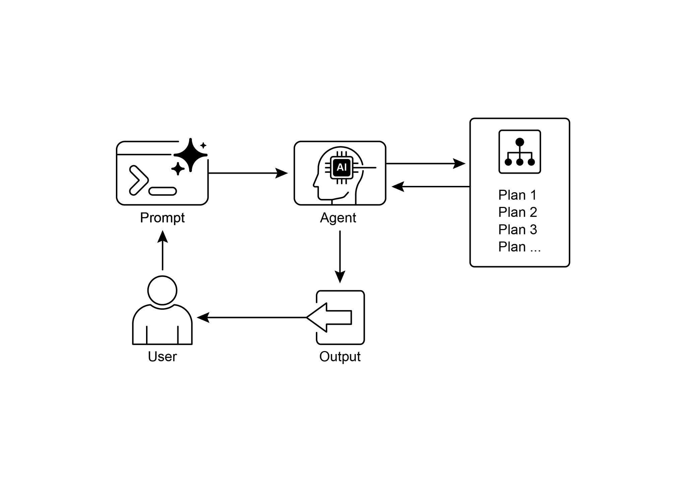

中间步骤，包括智能体的推理过程、它执行的具体网络搜索查询，以及它运行的任何代码。这便于详细调试、

分析，并更深入地理解最终答案是如何构建的。

● **可扩展性：** 它支持模型上下文协议（MCP），使

开发者能够将智能体连接到私有知识库和内部数据源，把公开网络研究与专有信息结合起来。

 

要使用该 API，你需要向 client.responses.create 端点发送请求，指定

模型、输入提示词，以及智能体可以使用的工具。输入通常包括

定义智能体角色与期望输出格式的系统提示词，以及 user_query。你还必须包含 web_search_preview 工具，并且可以

选择性地添加其他工具，例如 code_interpreter 或自定义模型上下文协议工具（见第 10 章），用于访问

内部数据。

```
# Access and print the final report from the response
final_report = response.output[-1].content[0].text
print(final_report)


# --- ACCESS INLINE CITATIONS AND METADATA ---
print("--- CITATIONS ---")

annotations = response.output[-1].content[0].annotations

if not annotations:
    print("No annotations found in the report.")
else:
    for i, citation in enumerate(annotations):
        # The text span the citation refers to
        cited_text = final_report[citation.start_index:citation.end_index]
        print("\nNo web search steps found.")

# 3. Code Execution: Any code run by the agent using the code interpreter.
try:
    code_step = next(item for item in response.output if item.type == "code_interpreter_call")
    print("\n[Found a Code Execution Step]")
    print(" Code Input:")
    print(f" ```python\n{code_step.input}\n ```")
    print(" Code Output:")
    print(f" {code_step.output}")
except StopIteration:
    print("\nNo code execution steps found.")
```

 

这段代码利用 OpenAI API 执行“深度研究”任务。它首先 **为何：** 规划模式提供了一种标准化方案，让智能体式系统

先制定连贯计划以达成目标。它将高层目标分解为一系列更小的、可执行的步骤或子目标。这使

系统能够管理复杂工作流、编排各类工具，并按

逻辑顺序处理依赖关系。大语言模型尤其适合这一任务，因为它们能够

基于海量训练数据生成合理且有效的计划。这种结构化方法将简单的反应式智能体转变为战略执行者，能够

主动推进复杂目标，并在必要时调整计划。

 

**经验法则：** 当用户的请求过于复杂，无法由单一操作或工具完成时，使用此模式。它非常适合自动化多步骤流程，例如

生成详细研究报告、为新员工办理入职，或执行

竞品分析。只要任务需要一系列

相互依赖的操作才能得到最终综合结果，就应应用规划模式。



## 关键要点

 

● 规划使智能体能够将复杂目标分解为可执行的、有序的

步骤。

● 它对于处理多步骤任务、工作流自动化，以及在

复杂环境中导航至关重要。

● 大语言模型可以通过基于

任务描述生成逐步方案来执行规划。

● 显式提示或将任务设计为需要规划步骤，有助于在

智能体框架中激发这种行为。

● Google 深度研究是一个代表我们分析来源的智能体，这些来源通过

将 Google Search 作为工具获得。它进行反思、规划并执行

 

## 结论
