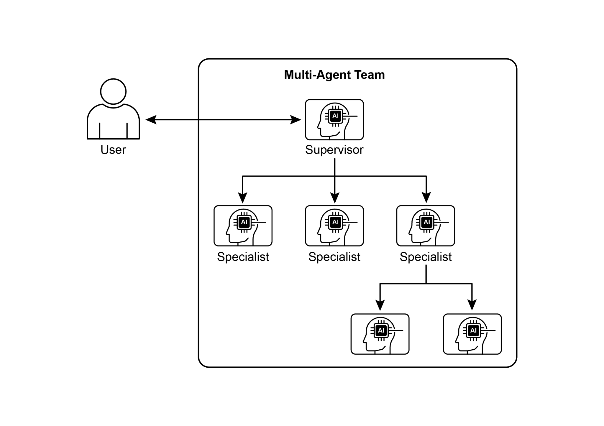
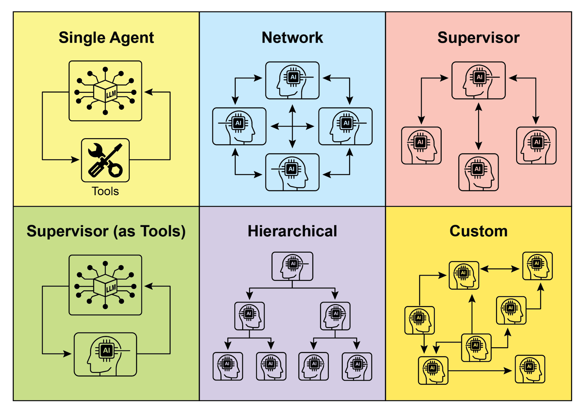

## [第 7 章：多智能体协作 ]

 

虽然单体智能体架构在定义明确的问题上可能有效，但其

能力在面对复杂、跨领域任务时往往受限。多智能体协作模式通过将系统组织为

由若干独立、专业化智能体组成的协作整体来应对这些局限。这一方法基于

任务分解原则，即将高层目标拆解

为离散的子问题。每个子问题再被分配给具备最适合该任务的特定工具、数据访问或推理能力的

智能体。

 

例如，一个复杂的研究查询可能被分解并分配给

研究智能体负责信息检索，数据分析智能体负责统计 [● ]**并行处理：** 多个智能体同时处理问题的不同部分

，随后再将其结果合并。

[● ]**辩论与共识：** 多智能体协作中，持有不同

视角与信息来源的智能体展开讨论以评估选项，

最终达成共识或做出更知情的决策。

[● ]**层级结构：** 管理者智能体可能根据工作智能体的工具访问或插件能力，动态地将任务委派给

工作智能体，并

综合其结果。每个智能体也可处理相关的工具组，

而非由单个智能体处理全部工具。

[● ]**专家团队：** 在不同领域具有专业知识的智能体（例如

研究员、写作者、编辑）协作以产出复杂成果。

**● 批评者-审阅者：** 智能体创建计划、草稿或答案等初始输出。随后由

第二组智能体批判性地评估该输出，检查其是否符合

政策、安全性、合规性、正确性、质量，以及与

以及第四个文档写作者。它们可以将输出在彼此之间传递，

以构建并验证组件。

[● ]**创意内容生成：** 创建营销活动可能涉及

市场研究智能体、文案智能体、平面设计智能体（使用图像

生成工具）以及社交媒体排期智能体，共同协作。

[● ]**金融分析：** 多智能体系统可分析金融市场。智能体

可能分别专长于获取股票数据、分析新闻情绪、执行

技术分析，以及生成投资建议。

[● ]**客户支持升级：** 一线支持智能体可处理初始

查询，在需要时将复杂问题升级给专家智能体（例如技术专家或计费专员），从而展示基于

问题复杂度的顺序交接。

[● ]**供应链优化：** 智能体可代表供应链中的不同节点

（供应商、制造商、分销商）并协作优化 **1. 单智能体：** 在最基本的层面上，「单智能体」自主运行，

不与其他实体直接交互或通信。虽然该模型实现与管理较为直接，但其能力本质上受限于

单个智能体的范围与资源。它适用于可分解

为独立子问题、且每个子问题可由单个自给自足的智能体解决的任务。

 

**2. 网络：** 「网络」模型代表迈向协作的重要一步，多个智能体以去中心化方式彼此直接交互。

通信通常以点对点方式进行，从而实现信息、

资源甚至任务的共享。该模型增强了韧性，因为单个智能体的故障

不一定会使整个系统瘫痪。然而，在大型、非结构化网络中管理通信开销并确保连贯的决策

可能具有挑战性。

以追求稳健性，以及可接受的通信开销。多智能体系统的未来进展

将很可能继续探索并完善这些模型，并开发协作智能的新范式。

 

[动手代码（Crew AI） ]

 

这段 Python 代码使用 CrewAI 框架定义了一个由 AI 驱动的 crew，用于

生成关于 AI 趋势的博客文章。它首先设置环境，从 .env 文件加载 API 密钥。应用的核心是定义两个智能体：一个

研究员负责发现并总结 AI 趋势，一个写作者基于

研究结果撰写博客文章。

 

相应地定义了两个任务：一个用于研究趋势，另一个用于

撰写博客文章，其中写作任务依赖于研究任务的输出

[\# 已更新为 Gemini 2.0 系列模型，以获得更好的 ][性能与功能。 ]

[\# 若需前沿（预览）能力，可使用 ][\"gemini-2.5-flash\". ]

[llm = ChatGoogleGenerativeAI(model=\"gemini-2.0-flash\") ]

 

[\# 定义具有特定角色与目标的智能体 ]

[researcher = Agent( ]

[role=\'Senior Research Analyst\', ]

[goal=\'Find and summarize the latest trends in AI.\', ]

[backstory=\"You are an experienced research analyst with a ][knack for identifying key trends and synthesizing information.\", ]

[verbose=True, ]

[allow_delegation=False, ]

[) ]

[blog_creation_crew = Crew( ]

[agents=\[researcher, writer\], ]

[tasks=\[research_task, writing_task\], ]

[process=Process.sequential, ]

[llm=llm, ]

[verbose=2 \# 设置详细程度以输出 crew 执行日志 ]

[) ]

 

[\# 执行 Crew ]

[print(\"## Running the blog creation crew with Gemini 2.0 Flash\... ][##\") ]

[try: ]

[result = blog_creation_crew.kickoff() ]

[print(\"\\n\-\-\-\-\-\-\-\-\-\-\-\-\-\-\-\-\--\\n\") ]

[print(\"## Crew Final Output ##\") ]

[print(result) ]

[from google.adk.agents import LlmAgent, BaseAgent ][from google.adk.agents.invocation_context import InvocationContext ][from google.adk.events import Event ]

 

[from typing import AsyncGenerator ]

 

[\# 通过扩展 BaseAgent 正确实现自定义智能体 ][class TaskExecutor(BaseAgent): ]

[\"\"\"一个具有自定义、非大语言模型行为的专用智能体。\"\"\" ]

[name: str = \"TaskExecutor\" ]
