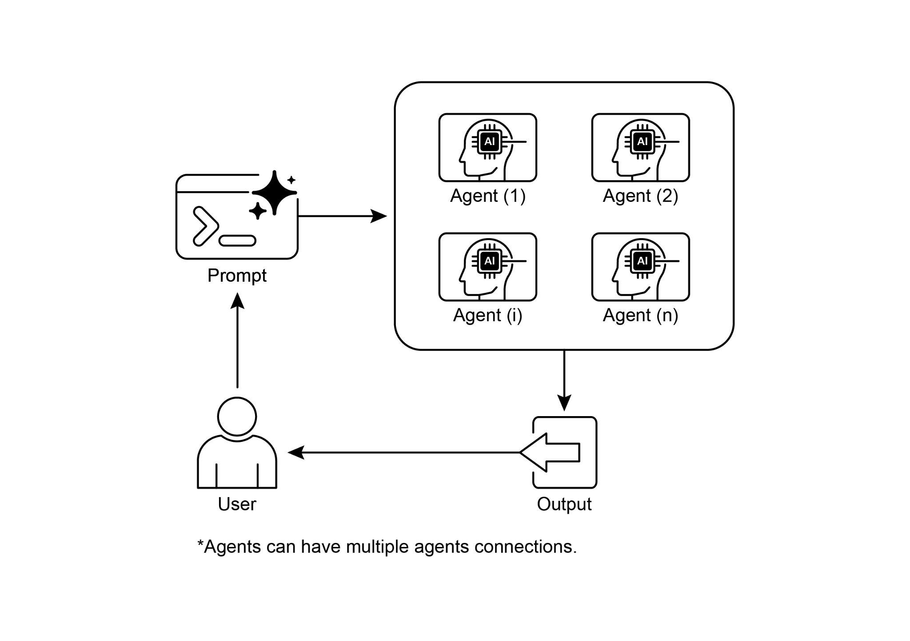

[description: str = \"执行预定义任务。\" ]

 

[async def \_run_async_impl(self, context: InvocationContext) -\> ][AsyncGenerator\[Event, None\]: ]

[\"\"\"任务的自定义实现逻辑。\"\"\" ][relationships. ]

[\# 这些断言在初始化后检查将会通过。 ][assert greeter.parent_agent == coordinator ][assert task_doer.parent_agent == coordinator ]

 

[print(\"Agent hierarchy created successfully.\") ]

 

这段代码摘录展示了如何在 Google ADK

框架中使用 LoopAgent 来建立迭代工作流。代码定义了两个智能体：

ConditionChecker 和 ProcessingStep。ConditionChecker 是一个自定义智能体，用于检查会话状态中的 \"status\" 值。如果 \"status\" 为 \"completed\"，

ConditionChecker 会升级一个事件以停止循环。否则，它会产出一个事件以

继续循环。ProcessingStep 是一个使用 \"gemini-2.0-flash-exp\"

模型的 LlmAgent。其指令是执行任务并将会话 \"status\" 设置为 \"completed\"

[is_done = (status == \"completed\") ]

 

[if is_done: ]

[\# 当条件满足时升级以终止循环。 ]

[yield Event(author=self.name, ]

[actions=EventActions(escalate=True)) ]

[else: ]

[\# 产出一个简单事件以继续循环。 ]

[yield Event(author=self.name, content=\"Condition not met, ][continuing loop.\") ]

 

[\# 更正：LlmAgent 必须具有模型和清晰的指令。 ][process_step = LlmAgent( ]

[name=\"ProcessingStep\", ]

[model=\"gemini-2.0-flash-exp\", ]这些子智能体。当使用初始输入运行管道时，step1 将首先执行。

step1 的响应将保存到会话状态的 \"data\" 键下。随后，step2 将执行，并按

其指令使用 step1 放入状态中的信息。这种结构允许构建工作流，其中

一个智能体的输出成为下一个智能体的输入。这是创建多步骤 AI

或数据处理管道时的常见模式。

 

[from google.adk.agents import SequentialAgent, Agent ]

 

[\# 此智能体的输出将保存到 session.state\[\"data\"\] ][step1 = Agent(name=\"Step1_Fetch\", output_key=\"data\") ]

 

[\# 此智能体将使用前一步的数据。 ]示例展示了如何在智能体执行完成后，从

final_state 访问收集到的天气和新闻数据。

 

[from google.adk.agents import Agent, ParallelAgent ]

 

[\# 最好将获取逻辑定义为智能体的工具 ][\# 为简化本示例，我们将逻辑嵌入 ]

[\# 智能体的指令中。 ]

[\# 在实际场景中，你应使用工具。 ]

 

[\# 定义将并行运行的各个智能体 ][weather_fetcher = Agent( ]

[name=\"weather_fetcher\", ]

[model=\"gemini-2.0-flash-exp\", ]函数是一个简单工具，用于模拟图像创建，返回模拟图像数据。

image_generator_agent 负责根据收到的文本提示词使用此工具。artist_agent 的角色是首先发明一个有创意的图像提示词。然后它通过 AgentTool 包装器调用

image_generator_agent。AgentTool 充当

桥梁，允许一个智能体将另一个智能体用作工具。当 artist_agent 调用

image_tool 时，AgentTool 会用艺术家发明的提示词调用 image_generator_agent。image_generator_agent 随后使用 generate_image 函数

与该提示词。最后，生成的图像（或模拟数据）通过各智能体逐层返回。

这种架构展示了一个分层智能体系统，其中

高层智能体编排底层专业化智能体来执行任务。

 

[from google.adk.agents import LlmAgent ]

[from google.adk.tools import agent_tool ][image_generator_agent = LlmAgent( ]

[name=\"ImageGen\", ]

[model=\"gemini-2.0-flash\", ]

[description=\"根据详细文本提示词生成图像。\", ]

[instruction=( ]

[\"You are an image generation specialist. Your task is to take ][the user\'s request \" ]

[\"and use the \`generate_image\` tool to create the image. \" ]

[\"The user\'s entire request should be used as the \'prompt\' ][argument for the tool. \" ]

[\"After the tool returns the image bytes, you MUST output the ][image.\" ]

[), ]

[tools=\[generate_image\] ]

[) ]结果，应对复杂的多领域目标变得低效，并可能

导致不完整或次优的结果。

 

**为何：** 多智能体协作模式通过创建

多个协作智能体组成的系统，提供了一种标准化解决方案。复杂问题被分解为

更小、更易管理的子问题。每个子问题随后被分配给

具备解决该问题所需精确工具与能力的专业化智能体。这些智能体通过已定义的通信协议和交互

模型（如顺序交接、并行工作流或层级委派）协同工作。这种

智能体式、分布式方法产生协同效应，使群体能够

达成任何单个智能体都无法实现的结果。

 

**经验法则：** 当任务对单个智能体过于复杂，且可以

分解为需要专业技能或工具的不同子任务时，使用此模式。它非常适合

跨多样领域的复杂、多方面问题。理解智能体

协作自然会导向对其与外部环境交互的探究。

 

[参考文献 ]

 

[1. Multi-Agent Collaboration Mechanisms: A Survey of LLMs, ]

[<https://arxiv.org/abs/2501.06322>]

[2. Multi-Agent System --- The Power of Collaboration, ]

[<https://aravindakumar.medium.com/introducing-multi-agent-frameworks-the-power-of-collaboration-e9db31bba1b6>]
