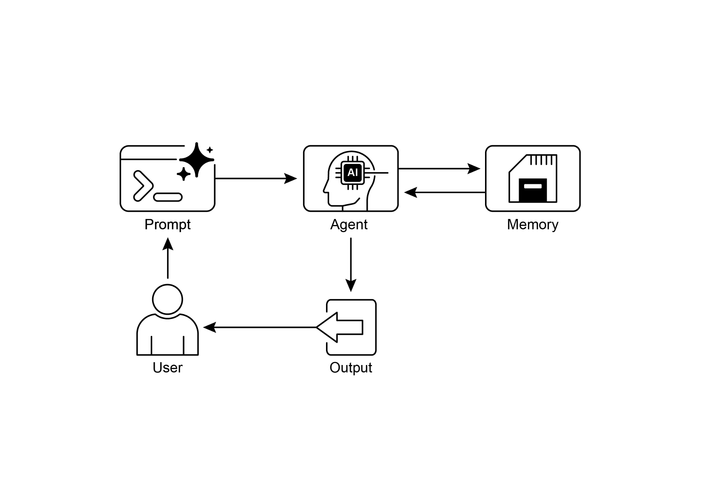

**是什么**：智能体式系统需要记住过往交互中的信息，才能

执行复杂任务并提供连贯的体验。若没有记忆

机制，智能体就是无状态的，无法维持对话上下文，也无法学习

[● ]像 Google ADK 这样的框架有特定组件，例如 Session（聊天线程）、State

（临时聊天数据）和 MemoryService（可搜索的长期知识），用于管理记忆。

[● ]Google ADK 的 SessionService 负责聊天会话的整个生命周期，包括其

历史（事件）和临时数据（状态）。

[● ]Google ADK 的 session.state 是一个存放临时聊天数据的字典。前缀（user:、app:、

temp:）标明数据归属以及是否持久保存。

[● ]在 Google ADK 中，应通过 EventActions.state_delta 或 output_key

在添加事件时更新状态，而不要直接修改状态字典。

[● ]Google ADK 的 MemoryService 用于将信息写入长期存储，并让智能体

搜索这些信息，通常借助工具完成。

● LangChain 提供了 ConversationBufferMemory 等实用工具，可自动

将单次对话的历史注入提示，使智能体能够

回忆即时上下文。

2. LangGraph Memory,

<https://langchain-ai.github.io/langgraph/concepts/memory/>

3. Vertex AI Agent Engine Memory Bank,

[https://cloud.google.com/blog/products/ai-machine-learning/vertex-ai-memory-bank-in-public-preview](https://cloud.google.com/blog/products/ai-machine-learning/vertex-ai-memory-bank-in-public-preview)
