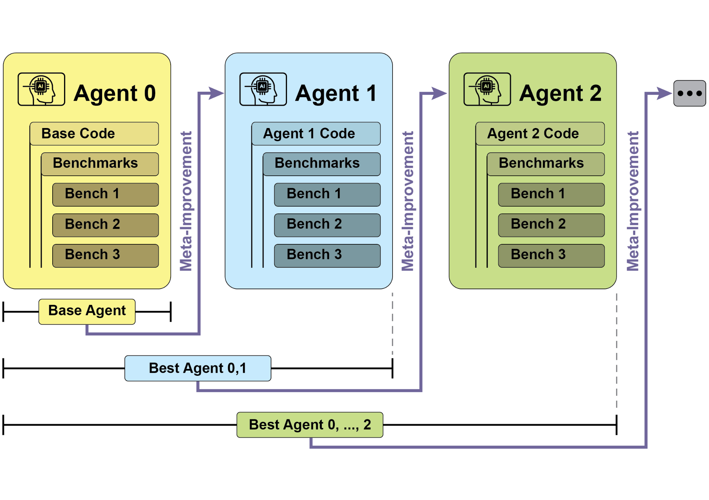
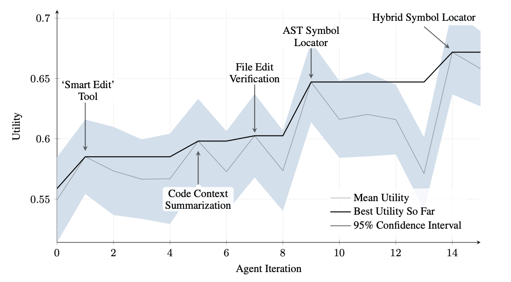
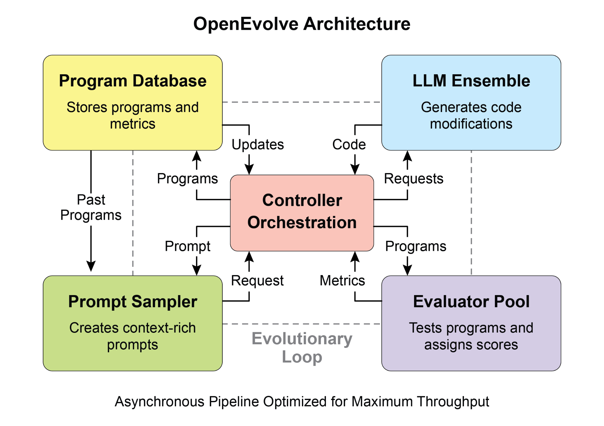
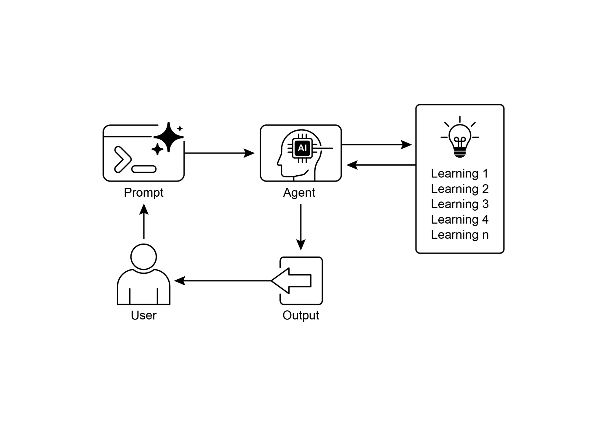

## [第 9 章：学习与适应 ]

 

学习与适应对于增强人工智能

智能体的能力至关重要。这些过程使智能体能够突破预定义参数，通过经验与

环境交互自主改进。借助学习与适应，智能体能够有效应对

新情境，并在无需持续人工干预的情况下优化自身表现。

本章将详细探讨支撑智能体学习与适应的原理与机制。

 

[全景概览 ]

 

智能体通过改变其思维、行动或知识来学习与适应，其基础是 **近端策略优化（Proximal Policy Optimization，PPO）**，这是一种强化学习算法，用于

在具有连续动作范围的环境中训练智能体，例如控制机器人的关节或游戏中的角色。其主要目标是可靠且稳定地改进

智能体的决策策略，即其策略（policy）。

 

PPO 的核心思想是对智能体的策略进行小幅、谨慎的更新。它

避免可能导致性能崩溃的剧烈变化。其工作方式如下：

 

1. 收集数据：智能体使用当前策略与环境交互（例如玩游戏），

并收集一批经验（状态、动作、奖励）。

2. 评估「代理」目标：PPO 计算潜在的策略更新

将如何改变期望奖励。然而，它并非仅仅最大化该

奖励，而是使用一种特殊的「裁剪」目标函数。

奖励模型。奖励模型在训练

博弈中充当「裁判」。

 

这一两步过程可能复杂且不稳定。例如，大语言模型可能找到

漏洞，并学会「钻空子」奖励模型，从而为糟糕的

回复打出高分。

 

● DPO 方法（直接过程）：DPO 完全跳过奖励模型。

它不是将人类偏好转换为奖励分数再

针对该分数优化，而是直接使用偏好数据来更新

大语言模型的策略。

● 其工作原理是利用一种将偏好数据直接关联到

最优策略的数学关系。本质上，它教导模型：「提高生成

类似*偏好*回复的概率，并降低

并最大限度地减少财务损失。

● **推荐智能体** 通过采用

用户偏好学习算法提高内容选择精度，提供高度个性化且

与上下文相关的推荐。

● **游戏 AI 智能体** 通过动态调整

策略算法提升玩家参与度，从而增加游戏复杂度与挑战性。

● **知识库学习智能体**：智能体可借助检索增强

生成（RAG）维护由问题

描述与已验证解决方案组成的动态知识库（参见第 14 章）。通过存储成功的

策略与所遇挑战，智能体可在决策时参考这些数据，从而通过

应用先前成功的模式或规避已知陷阱，更有效地适应新情境。

 

[案例研究：自改进编码智能体 ]

从而缩短处理时间并降低成本。最初，文件变更以 diff 形式记录，

仅显示修改内容，并定期合并。

 

**SICA：代码一览：** 深入考察 SICA 的实现，可以发现若干

支撑其能力的关键设计选择。如前所述，该系统采用

模块化架构，包含多个子智能体，例如编码智能体、

问题解决智能体与推理智能体。这些子智能体由主智能体调用，类似于工具调用，用于分解复杂任务并高效

管理上下文长度，尤其是在那些延长的元改进

迭代过程中。

 

该项目仍在积极开发中，旨在为有兴趣在工具使用及其他智能体式任务上对大语言模型进行后训练的人提供稳健框架，完整代码

可供进一步探索与贡献，以促进大语言模型智能体的开放式学习与真正创造力，这仍是当前研究中的一个关键

探索领域。

 

[AlphaEvolve 与 OpenEvolve ]

 

**AlphaEvolve** 是 Google 开发的一款 AI 智能体，旨在发现与优化

算法。它结合使用大语言模型（具体为 Gemini 模型，包括 Flash 与

Pro）、自动化评估系统以及进化算法框架。该

系统旨在推进理论数学与实际计算应用。

 

AlphaEvolve 采用 Gemini 模型集成。Flash 用于生成

广泛的初始算法提案，而 Pro 则为任意大语言模型提供更深入的分析。此外，它还纳入多目标优化，支持

灵活的提示工程，并能进行分布式评估，以高效处理复杂的编码挑战。

[\# 初始化系统 ]

[evolve = OpenEvolve( ]

[initial_program_path=\"path/to/initial_program.py\", ]

[evaluation_file=\"path/to/evaluator.py\", ]

[config_path=\"path/to/config.yaml\" ]

[) ]

 

[\# 运行进化 ]

[best_program = await evolve.run(iterations=1000) ][print(f\"Best program metrics:\") ]

[for name, value in best_program.metrics.items(): ]

[print(f\" {name}: {value:.4f}\") ]

 

[一览 ]

[● ]构建能够学习的智能体，通常意味着将它们与机器学习

工具对接，并管理数据如何流动。

[● ]配备基本编码工具的智能体系统可自主编辑自身，

从而提升其在基准任务上的表现

[● ]AlphaEvolve 是 Google 的 AI 智能体，它利用大语言模型与进化

框架自主发现并优化算法，显著增强基础研究与实际计算应用。

 

[结论 ]

 

本章探讨学习与适应在人工
