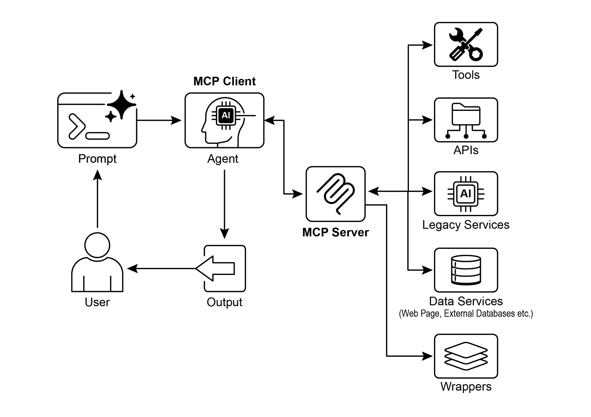

[from google.adk.agents import LlmAgent ]

[from google.adk.tools.mcp_tool.mcp_toolset import MCPToolset, ][StdioServerParameters ]

[TARGET_FOLDER_PATH, ]

[], ]

[), ]

[\# 可选：你可以过滤从 MCP 服务器暴露哪些工具。 ]

[\# 例如，仅允许读取： ]

[\# tool_filter=\[\'list_directory\', \'read_file\'\] ]

[) ]

[], ]

[) ]

 

\`npx\`（Node Package Execute，随 npm（Node Package Manager）5.2.0 及更高版本捆绑）是一种工具，可直接从 npm 注册表执行 Node.js 包。这样就无需进行全局安装。本质上，\`npx\` 用于

在 Python 语境中，UVX 指的是一种命令行工具，它利用 uv 在临时、隔离的 Python 环境中执行命令。本质上，它让你可以

 

运行 Python 工具和包，而无需将其全局安装，或安装到你的

项目环境中。你可以通过 MCP 服务器运行它。

 

[connection_params = StdioConnectionParams( ][ server_params={ ]

[\"command\": \"uvx\", ]

[\"args\": \[\"mcp-google-sheets@latest\"\], ]

[\"env\": { ]

[\"SERVICE_ACCOUNT_PATH\":SERVICE_ACCOUNT_PATH, ]

[\"DRIVE_FOLDER_ID\": DRIVE_FOLDER_ID ]

[} ]

[ } ]

[使用 FastMCP 创建 MCP 服务器 ]

 

FastMCP 是一个高级 Python 框架，旨在简化 MCP 服务器的开发。它提供了一层抽象，降低了协议复杂性，

使开发者能够专注于核心逻辑。

 

该库支持使用简单的 Python 装饰器快速定义工具、资源和提示。其一大优势是自动生成 schema，它会

智能解读 Python 函数签名、类型提示和文档

字符串，以构建所需的 AI 模型接口规范。这种自动化

能最大限度减少手动配置，并降低人为错误。

 

除了基本的工具创建之外，FastMCP 还支持高级架构模式，例如

服务器组合与代理。这使得复杂系统的模块化开发成为可能，

[name: 要问候的人的姓名。 ]

 

[Returns: ]

[问候字符串。 ]

[\"\"\" ]

[return f\"Hello, {name}! Nice to meet you.\" ]

 

[\# 或者如果你想从脚本运行它： ]

[if \_\_name\_\_ == \"\_\_main\_\_\": ]

[mcp_server.run( ]

[transport=\"http\", ]

[host=\"127.0.0.1\", ]

[port=8000 ]

[) ]

 

这段 Python 脚本定义了一个名为 greet 的函数，它接收一个人的姓名

并返回个性化问候。该函数上方的 \@tool() 装饰器 ADK 智能体，并使用 HttpServerParameters 与

正在运行的 FastMCP 服务器建立连接。

 

[\# ./adk_agent_samples/fastmcp_client_agent/agent.py ][import os ]

[from google.adk.agents import LlmAgent ]

[from google.adk.tools.mcp_tool.mcp_toolset import MCPToolset, ][HttpServerParameters ]

 

[\# 定义 FastMCP 服务器的地址。 ]

[\# 确保你的 fastmcp_server.py（前面已定义）正在该端口上运行。 ]

[FASTMCP_SERVER_URL = \"http://localhost:8000\" ]

 

[root_agent = LlmAgent( ]

[model=\'gemini-2.0-flash\', \# 或你偏好的模型 ]在 fastmcp_client_agent 目录中创建 \_\_init\_\_.py 文件是必要的。这

可确保该智能体被识别为可供 Google ADK 发现的 Python 包。

 

首先，打开一个新终端并运行 \`python fastmcp_server.py\` 以启动

FastMCP 服务器。接着，在终端中进入 \`fastmcp_client_agent\` 的父目录（例如

\`adk_agent_samples\`），并执行 \`adk web\`。一旦

Google ADK Web UI 在浏览器中加载，从智能体菜单中选择 \`fastmcp_greeter_agent\`。然后你可以

通过输入诸如“Greet John Doe.”的提示来测试它。智能体将

使用你 FastMCP 服务器上的 \`greet\` 工具来生成响应。

 

[一览 ]

 

**是什么：** 要成为有效的智能体，大语言模型必须超越简单的文本生成。它们需要能够与外部环境交互，以获取 **可视化摘要**

生成式媒体能力（Imagen、Veo、Chirp 3 HD、Lyria）。

● MCP 使大语言模型和智能体能够与现实世界系统交互、访问

动态信息，并执行超出文本生成范围的操作。

 

[结论 ]

 

模型上下文协议（MCP）是一种开放标准，用于促进

大语言模型（LLM）与外部系统之间的通信。它采用客户端-服务器架构，使大语言模型能够访问资源、使用提示，并通过标准化工具

执行操作。MCP 允许大语言模型与

数据库交互、管理生成式媒体工作流、控制物联网设备，并实现

金融服务自动化。实际示例展示了如何设置智能体以与 MCP 服务器通信，包括文件系统服务器以及用 FastMCP 构建的服务器，

说明了它与 Google ADK（Agent Development Kit）的集成。MCP 是一个关键
