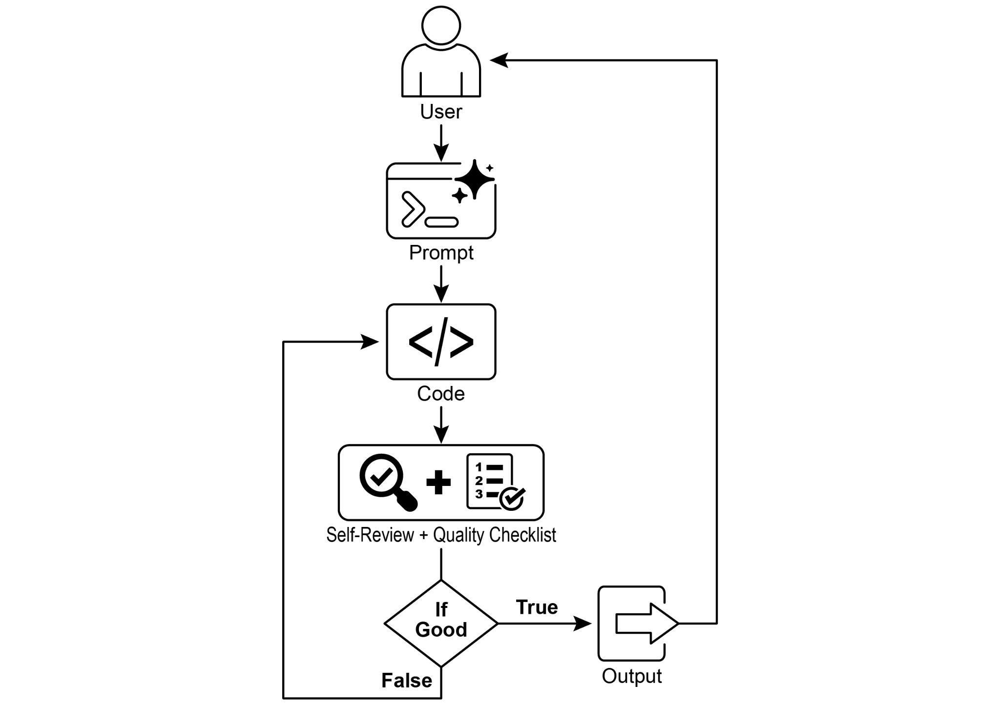

## 第11章：目标设定与监控

 

要使 AI 智能体真正有效且有目标感，它们需要的不只是处理信息或使用工具的能力；它们还需要清晰的方向感，以及判断自己是否真正取得成功的方法。这正是目标设定与监控模式发挥作用之处。该模式旨在为智能体设定具体目标以供推进，并为其配备跟踪进度、判断这些目标是否已达成的手段。

 

### 目标设定与监控模式概览

 
 
想想规划一次旅行。你不会突然凭空出现在目的地。

你先决定要去哪里（目标状态），再弄清自己从哪里出发 ● **客户支持自动化：** 智能体的目标可能是「解决客户的

账单咨询」。它监控对话、检查数据库条目，并使用工具调整账单。成功与否通过确认账单变更并收到正面客户反馈来监控。若问题未解决，则进行升级。

● **个性化学习系统：** 学习智能体的目标可能是

「提高学生对代数的理解」。它监控学生在练习中的进度，调整教学材料，并跟踪准确率和完成时间等

绩效指标；若学生遇到困难，则调整其方法。

● **项目管理助手：** 智能体可能被指派「确保

项目里程碑 X 在 Y 日期前完成」。它监控任务状态、团队沟通与资源可用性，在目标面临风险时标记延误并提出纠正措施。

● **自动化交易机器人：** 交易智能体的目标可能是「在风险承受范围内最大化投资组合收益」。它持续监控市场数据，其智能体的成功由其自身基于 AI 的判断来衡量：所生成的代码是否成功满足初始目标。最终输出是一份打磨完善、带有注释、可直接使用的 Python 文件，代表这一精炼过程的成果。

 

**依赖：**

 

[pip install langchain_openai openai python-dotenv ][.env 文件中需包含 OPENAI_API_KEY 密钥 ]

 

理解该脚本的最佳方式，是把它想象成被指派到某个项目的自主 AI 程序员（见图 1）。流程始于你向 AI 提交一份详细的

项目简报，即它需要解决的具体编程问题。[from dotenv import load_dotenv, find_dotenv ]

 

[\# ][🔐][ 加载环境变量 ][\_ = load_dotenv(find_dotenv()) ]

[OPENAI_API_KEY = os.getenv(\"OPENAI_API_KEY\") ][if not OPENAI_API_KEY: ]

[raise EnvironmentError(\"][❌][ 请设置 OPENAI_API_KEY ][环境变量。\") ]

 

[\# ][✅][ 初始化 OpenAI 模型 ]

[print(\"][📡][ 正在初始化 OpenAI 大语言模型 (gpt-4o)\...\") ][llm = ChatOpenAI( ]

[model=\"gpt-4o\", \# 若无法访问 gpt-4o，请使用其他 ][OpenAI 大语言模型 ]

[temperature=0.3, ]

[openai_api_key=OPENAI_API_KEY, ]

[def get_code_feedback(code: str, goals: list\[str\]) -\> str: ]

 

[print(\"][🔍][ 正在根据目标评估代码\...\") ]

[feedback_prompt = f\"\"\" ]

[你是一名 Python 代码审查员。下方展示了一段代码片段。 ][请根据以下目标： ]

 

[{chr(10).join(f\"- {g.strip()}\" for g in goals)} ]

 

[请批评此代码并判断目标是否已达成。 ][说明在清晰性、简洁性、正确性、边界情况处理或测试覆盖方面是否需要改进。 ]

 

[代码： ]

[{code} ]

[\"\"\" ]

[lines = lines\[:-1\] ]

[return \"\\n\".join(lines).strip() ]

 

[def add_comment_header(code: str, use_case: str) -\> str: ]

[comment = f\"# 此 Python 程序实现以下用例：\\n# {use_case.strip()}\\n\" ]

[return comment + \"\\n\" + code ]

 

[def to_snake_case(text: str) -\> str: ]

[text = re.sub(r\"\[\^a-zA-Z0-9 \]\", \"\", text) ]

[return re.sub(r\"\\s+\", \"\_\", text.strip().lower()) ]

 

[def save_code_to_file(code: str, use_case: str) -\> str: ]

[print(\"][💾][ 正在将最终代码保存到文件\...\") ]

 

[summary_prompt = ( ]

[feedback = \"\" ]

 

[for i in range(max_iterations): ]

[print(f\"\\n=== ][🔁][ 第 {i + 1} 次迭代，共 {max_iterations} 次 ===\") ]

[prompt = generate_prompt(use_case, goals, previous_code, ][feedback if isinstance(feedback, str) else feedback.content) ]

 

[print(\"][🚧][ 正在生成代码\...\") ]

[code_response = llm.invoke(prompt) ]

[raw_code = code_response.content.strip() ]

[code = clean_code_block(raw_code) ]

[print(\"\\n][🧾][ 生成的代码：\\n\" + \"-\" \* 50 + f\"\\n{code}\\n\" + ][\"-\" \* 50) ]

 

[print(\"\\n][📤][ 正在提交代码以进行反馈审查\...\") ]

[feedback = get_code_feedback(code, goals) ][当前目录及其所有嵌套子目录，并打印 ][总数\" ]

[\# goals_input = ( ]

[\# \"代码易于理解，功能正确，处理全面的边界情况，忽略性能方面的建议，忽略使用 unittest 或 pytest 等测试套件的建议\" ]

[\# ) ]

[\# run_code_agent(use_case_input, goals_input) ]

 

[\# 示例 3 ]

[\# use_case_input = \"编写代码，接收命令行输入的 Word 文档或 docx 文件，打开它并统计其中的单词数和字符数，并全部打印出来\" ]

[\# goals_input = \"代码易于理解，功能正确，处理边界情况\" ]

[\# run_code_agent(use_case_input, goals_input) ]

代码通过最终检查后，脚本会打包打磨好的解决方案，添加有用的注释，并将其保存到一个干净的新 Python 文件中，以供使用。

 

**注意事项与考量：** 需要指出的是，这只是示例性说明，而非生产就绪代码。对于实际应用，必须考虑若干因素。大语言模型可能无法完全理解某个目标的预期含义，并可能错误地将其表现评估为成功。即便目标已被充分理解，模型仍可能产生幻觉。当同一个大语言模型既负责编写代码又负责评判其质量时，它可能更难发现其
