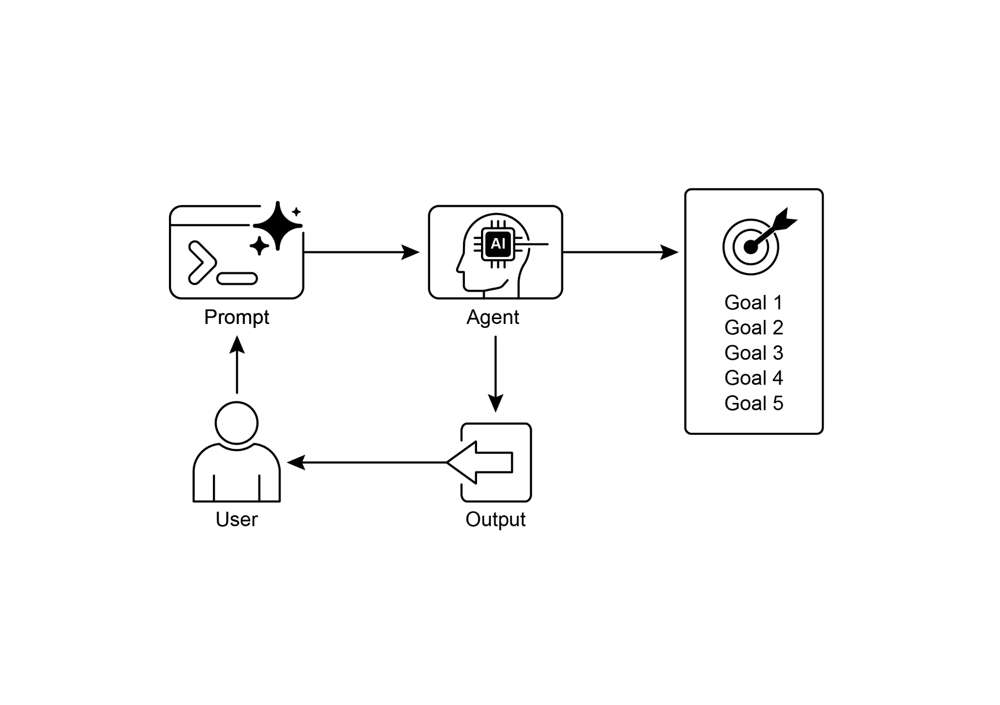

正朝着错误的方向发展。

 

归根结底，大语言模型并不会凭空产出完美无缺的代码；你仍然需要运行并测试生成的代码。此外，简单示例中的「监控」较为基础，

存在流程无限运行的潜在风险。

● 同伴程序员：协助编写代码并参与头脑风暴。

● 代码审查员：捕捉错误并提出改进建议。 ● 文档撰写者：生成清晰简洁的文档。

● 测试编写者：创建全面的单元测试。

● 提示优化者：优化与 AI 的交互。

 

在这个多智能体系统中，代码审查员作为独立于程序员智能体的实体，其提示词类似于示例中的评判者，

这显著提升了客观评估效果。这种结构自然导向更佳实践，因为测试编写者智能体可以满足为同伴程序员所生成代码编写单元测试的需求。

 

我把添加这些更精细的控制、使代码更接近生产就绪的任务留给感兴趣的读者。

**可视化总结**：

通过状态管理和工具交互实现的监控。

 

## 结论

 

本章聚焦于目标设定与监控这一关键范式。我

强调了这一概念如何将智能体从单纯的反应式系统转变为

主动、目标驱动的实体。文中强调了定义清晰、

可衡量目标，并建立严格监控流程以跟踪进展的重要性。实际应用表明，该范式如何在包括客户服务与

机器人在内的多个领域支撑可靠的自主运行。一个概念性编码示例说明了如何在结构化框架中实现这些

原则，利用智能体指令与状态管理来引导并评估智能体达成其既定目标的情况。

归根结底，使智能体具备制定并监督目标的能力，是一个
