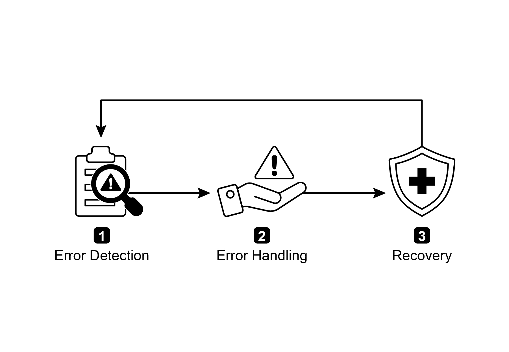
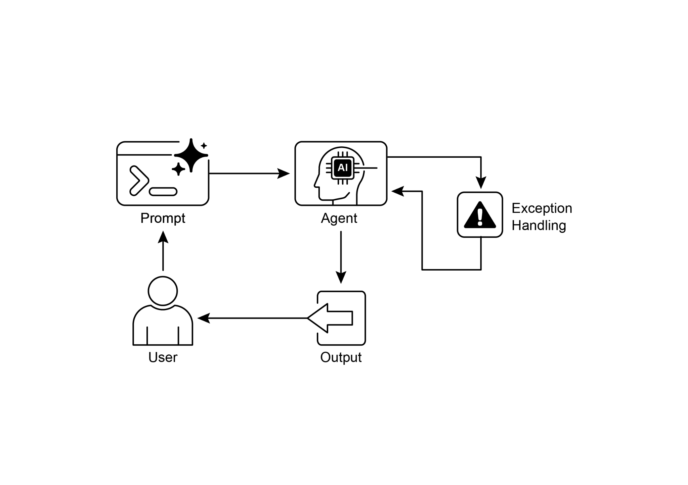

## [第 12 章：异常处理与 ]

 

[恢复 ]

 

为使 AI 智能体在多样的现实环境中可靠运行，它们必须能够

应对意外情况、错误与故障。正如人类会适应意外障碍一样，智能体需要稳健的系统来检测问题、

启动恢复流程，或至少确保可控地失败。这一基本

要求构成了异常处理与恢复模式的基础。

 

该模式侧重于打造极为耐久且有韧性的智能体，使其能够

在各种困难与异常面前，仍保持不间断的功能与运行完整性。它强调主动准备与通知的重要性。此外，该模式还强调状态回滚、诊断、自我纠正与升级等恢复机制，以将智能体恢复到稳定运行状态。实施该模式可增强 AI

智能体的可靠性与稳健性，使其能在不可预测的环境中运行。实际应用

示例包括处理数据库错误的聊天机器人、应对金融错误的交易机器人，

以及处理设备故障的智能家居智能体。该模式确保智能体在遭遇

复杂性与故障时仍能有效继续运行。

降级）。最后，在需要人工介入或协作的情况下，向人类操作员或其他智能体发出警报可能至关重要（通知）。

 

**恢复：** 此阶段旨在错误发生后，将智能体或系统恢复到稳定且

可运行的状态。可能包括撤销近期变更或

事务，以消除错误的影响（状态回滚）。对错误原因进行彻底调查

对于防止再次发生至关重要。可能需要通过自我纠正机制或重新规划过程，调整智能体的计划、逻辑或参数，

以避免将来出现相同错误。在复杂或严重的情况下，

将问题委派给人类操作员或更高层系统（升级）可能

是最佳行动方案。

 

实施这一稳健的异常处理与恢复模式，可将

AI 智能体从脆弱不可靠的系统转变为稳健、可信赖的组件 [● ]**网页抓取智能体：** 当网页抓取智能体遇到验证码（CAPTCHA）、

网站结构变更，或服务器错误（例如 404 Not Found、503 Service Unavailable）时，需要优雅地处理这些情况。可以包括暂停、使用

代理，或报告失败的具体 URL。

[● ]**机器人与制造业：** 执行装配任务的机械臂可能因未对准而

未能抓取零件。它需要检测到这一失败（例如通过传感器反馈），尝试重新调整、重试抓取，若问题持续，

则提醒人类操作员或切换到其他零件。

 

简言之，该模式对于构建不仅智能、而且在面对现实世界复杂性时

仍可靠、有韧性且用户友好的智能体而言，至关重要。

 

[实操代码示例（ADK） ]

 

异常处理与恢复对系统稳健性与可靠性至关重要。

[tools=\[get_general_area_info\] ]

[) ]

 

[\# 智能体 3：根据状态呈现最终结果。 ][response_agent = Agent( ]

[name=\"response_agent\", ]

[model=\"gemini-2.0-flash-exp\", ]

[instruction=\"\"\" ]

[Review the location information stored in state\[\"location_result\"\]. ][Present this information clearly and concisely to the user. ][If state\[\"location_result\"\] does not exist or is empty, apologize ][that you could not retrieve the location. ]

[\"\"\", ]

[tools=\[\] \# 该智能体仅基于最终状态进行推理。 ][) ]障碍。这种不可靠性使其难以部署到要求性能稳定的关键或复杂

应用中。

 

**为何**：异常处理与恢复模式为构建稳健且有韧性的 AI 智能体

提供了标准化解决方案。它赋予智能体预判、管理并从运行故障中恢复的智能体式能力。该模式包括

主动错误检测（例如监控工具输出与 API 响应），以及记录日志以供诊断、重试瞬时故障或

使用回退机制等反应式处理策略。对于更严重的问题，它定义了恢复协议，

包括回退到稳定状态、通过调整计划进行自我纠正，或将问题升级

给人类操作员。这种系统化方法确保智能体能够在不可预测的环境中保持运行完整性、从失败中学习，并可靠地运行。

[结论 ]

 

本章探讨异常处理与恢复模式，该模式对于开发稳健、可信赖的 AI 智能体至关重要。该模式阐述 AI

智能体如何识别并管理意外问题、实施适当

响应，并恢复到稳定运行状态。本章讨论了该模式的多个

方面，包括错误检测、通过日志记录、重试与回退等机制处理这些错误，以及用于

将智能体或系统恢复到正常功能的策略。异常处理与恢复模式在多个领域的实际应用

被用来说明其在应对现实世界复杂性与潜在故障方面的相关性。这些应用表明，为 AI 智能体配备异常处理能力

如何提升其在动态环境中的可靠性与适应性。
