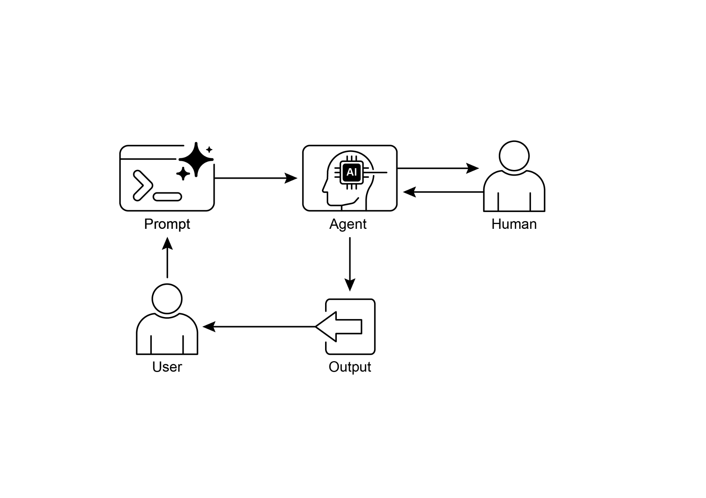

## [第 13 章：人在环路 ]

 

人在环路（HITL）模式是智能体开发与部署中的一项关键策略。它刻意将人类认知的独特优势——例如判断力、创造力与细致入微的

理解——与 AI 的计算能力与效率交织在一起。这种战略性

整合往往不只是可选项，而是必要之举，尤其是当 AI 系统

日益嵌入关键决策流程之时。

 

人在环路的核心原则是确保 AI 在伦理边界内运行，

遵守安全协议，并以最优效果达成目标。

这些问题在以复杂性、模糊性或重大风险为特征的领域尤为突出，在这些领域中，AI 错误或误读的影响 [人在环路模式概览 ]

 

人在环路（HITL）模式将人工智能与人类输入相结合，以增强智能体能力。该方法承认，最优的 AI

性能往往需要自动化处理与人类

洞察的结合，尤其是在高度复杂或涉及伦理考量的场景中。人在环路

并非要取代人类输入，而是旨在增强人类能力，确保关键判断与决策由人类理解所支撑。

 

人在环路涵盖若干关键方面：人类监督，即监控

智能体的表现与输出（例如通过日志审查或实时仪表盘），以确保遵守指南并防止不良结果。干预与

纠正发生在智能体遇到错误或模糊场景时，并

可能请求人类干预；人类操作员可以纠正错误、补充缺失信息以提高准确性。此外，该模式的有效性高度依赖于

人类操作员的专业能力；例如，虽然 AI 可以生成软件代码，但只有熟练的开发者才能准确识别细微错误并提供

正确的修复指导。在使用人在环路生成训练数据时，同样需要专业知识，因为人类标注者可能需要特殊培训，才能学会如何

以产生高质量数据的方式纠正 AI。最后，实施人在环路会带来重大隐私问题，因为敏感信息在暴露给人类操作员之前通常必须经过严格

匿名化处理，从而增加了另一层

流程复杂性。

 

[实际应用与用例 ]

 

人在环路模式在众多行业与

应用中至关重要，尤其是在准确性、安全、伦理或细致理解

音频，提供 AI 学习所依据的真实标注。这是一个持续

过程，随模型演进而持续进行。

[● ]**生成式 AI 精炼：** 当大语言模型生成创意内容（例如

营销文案、设计创意）时，人类编辑或设计师会审查并打磨

输出，确保其符合品牌指南、与目标受众产生共鸣，

并保持质量。

**● 自主网络：** AI 系统能够分析告警，并

利用关键绩效指标（KPI）与已识别模式来预测网络问题与流量异常。然而，关键决策——例如

处理高风险告警——经常会升级给人类分析师。这些分析师开展进一步调查，并就网络变更的批准做出最终决定。

 

该模式体现了一种务实的 AI 实施方法。它利用 AI 来

根据人类操作员提供的较慢、战略性指导，调节即时行动的数量。

 

[动手代码示例 ]

 

为演示人在环路模式，Google ADK 智能体可以识别需要人类审查的场景，

并启动升级流程。这使得在智能体自主决策能力有限、或需要复杂判断的情况下，可以进行人类干预。这并非孤立特性；

其他流行框架也已采用类似能力。例如，LangChain

也提供实现此类交互的工具。

 

[from google.adk.agents import Agent ]

[from google.adk.tools.tool_context import ToolContext ][对于超出基本故障排查的复杂问题： ][1. 使用 escalate_to_human 转接给人类专家。 ][保持专业且富有同理心的语气。承认 ][技术问题可能带来的挫败感，同时提供清晰的 ][解决步骤。 ]

[\"\"\", ]

[tools=\[troubleshoot_issue, create_ticket, escalate_to_human\] ][) ]

 

[def personalization_callback( ]

[callback_context: CallbackContext, llm_request: LlmRequest ][) -\> Optional\[LlmRequest\]: ]

[\"\"\"向大语言模型请求添加个性化信息。\"\"\" ]

[\# 从状态获取客户信息 ]

[customer_info = callback_context.state.get(\"customer_info\") ]

[if customer_info: ]支持工作流。升级工具是人在环路设计的核心部分，确保

复杂或敏感案例被转交给人类专家。

 

该架构的一个关键特性是其深度个性化能力，通过

专用回调函数实现。在联系大语言模型之前，该函数

从智能体状态中动态检索客户特定数据——例如姓名、层级与购买

历史。随后将这些上下文作为系统消息注入提示，使智能体能够提供高度定制且信息充分的

响应，并引用用户的历史记录。通过将结构化工作流与

必要的人类监督及动态个性化相结合，这段代码成为

Google ADK 如何促进开发复杂且稳健的 AI 支持解决方案的实用示例。

 

[一览 ]高质量的人类标注数据，或精炼生成式 AI 输出以满足特定

质量标准。

 

**可视化摘要：**

● 人在环路的主要缺点是其固有的可扩展性不足，
