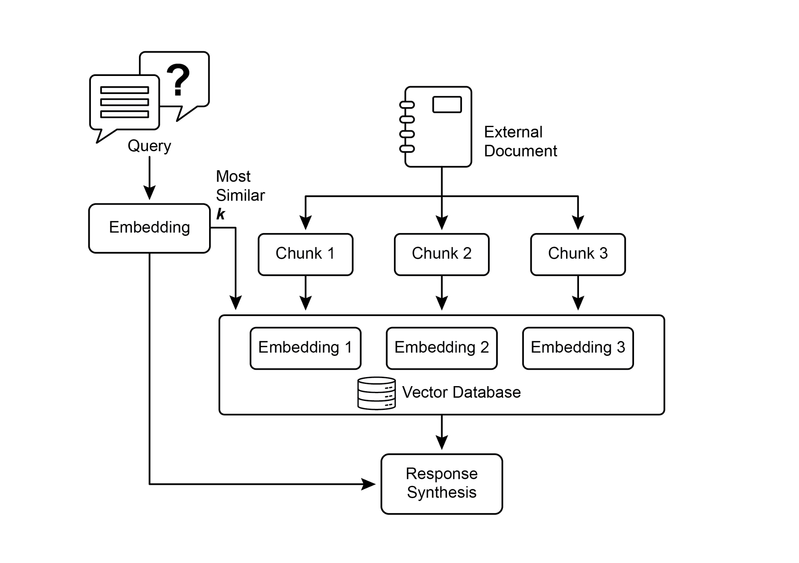
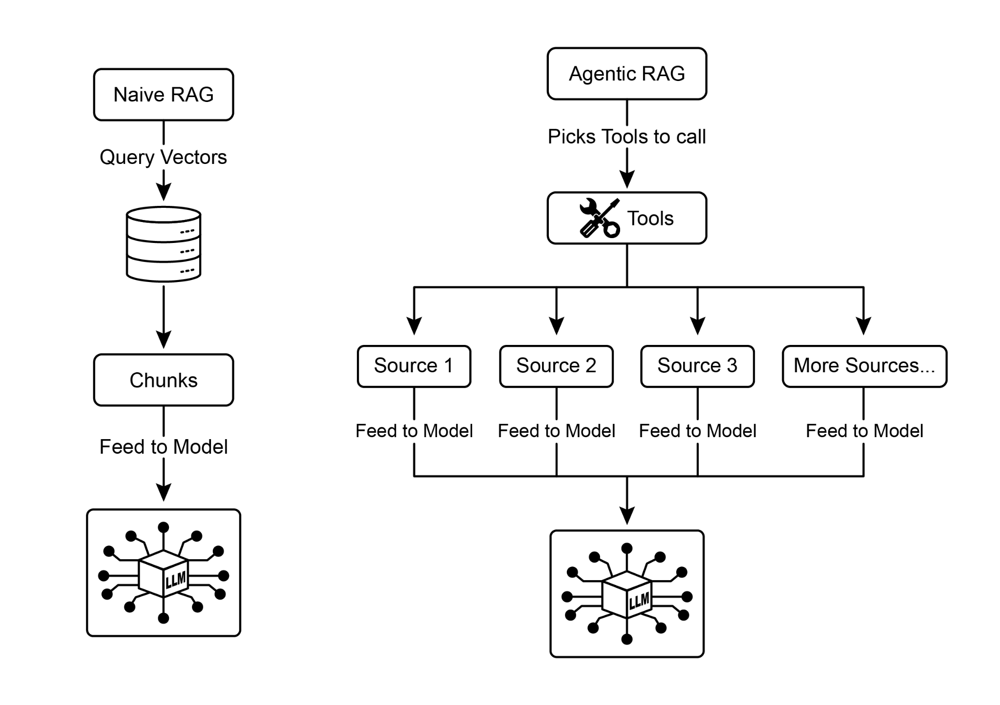

## [第14章：知识检索（检索增强生成）]

 

大语言模型在生成类人文本方面展现出强大能力。然而，它们的

知识库通常局限于其训练所用的数据，难以获取实时信息、特定公司数据或高度专业化的

细节。知识检索（检索增强生成，即 RAG）正是为解决

这一局限而生。检索增强生成使大语言模型能够访问并整合外部的、最新的、

上下文特定的信息，从而提升其输出的准确性、相关性与事实依据。

 

对 AI 智能体而言，这一点至关重要，因为它使智能体能够将其行动与回复建立在

静态训练之外的实时、可验证数据之上。这一能力使它们能够

准确完成复杂任务，例如访问最新的公司政策到数据。该方法还通过将回复建立在可验证数据上，降低了“幻觉”——即生成虚假

信息——的风险。此外，大语言模型可以利用公司内部文档或维基中的专业知识。该过程的一个关键

优势是能够提供“引文”，精确指出

信息的确切来源，从而增强

AI 回复的可信度与可验证性。

 

要充分理解检索增强生成如何运作，有必要先掌握若干核心

概念（见图1）：

 

**嵌入（Embeddings）**：在大语言模型的语境中，嵌入是文本的数值表示，

例如词语、短语或整篇文档。这些表示以向量形式存在，即一串数字。其核心思想是在数学上捕捉不同文本片段之间的语义

含义与关系，识别它们指代同一事物，并会认为它们高度

相似。这是因为它们的嵌入在向量空间中非常接近，表明语义距离很小。正是这种“智能搜索”，使检索增强生成即使在用户措辞与

知识库中的文本并不完全匹配时，也能找到

相关信息。

使检索过程更快，并让提供给大语言模型的信息更加聚焦、

更贴合用户的即时需求。文档分块完成后，检索增强生成系统必须采用检索技术，为给定查询找到最相关的片段。

主要方法是向量搜索，它利用嵌入与语义距离

来查找与用户问题在概念上相似的块。一种较旧但仍

有价值的技术是 BM25，这是一种基于关键词的算法，按词频对块进行排序，而不理解语义含义。为兼取两者之长，

通常会采用混合搜索方法，将 BM25 的关键词精确性与

语义搜索的上下文理解能力相结合。这种融合能够实现

更稳健、更准确的检索，既捕捉字面匹配，也捕捉概念相关性。

 

**向量数据库：** 向量数据库是一种专门用于

高效存储与查询嵌入的数据库。文档被分块并转换之后，高度依赖于分块与检索过程的质量；若检索到不相关的

块，就会引入噪声并干扰大语言模型。此外，有效综合可能相互矛盾的来源中的信息，仍是这些系统面临的

重大障碍。除此之外，另一项挑战是：检索增强生成

要求整个知识库预先处理并存储在专用的

数据库中，例如向量数据库或图数据库，这是一项相当大的工程。因此，这些知识需要定期同步以保持更新，在处理

公司维基等不断演变的来源时，这是一项关键任务。整个

过程可能对性能产生明显影响，增加延迟、运营

成本，以及最终提示词中使用的 token 数量。

 

总之，检索增强生成（RAG）模式标志着

使 AI 更有知识、更可靠方面的重大进步。通过将外部知识检索步骤无缝

整合到生成过程中，检索增强生成维护成本。总之，它在深度、相互关联的洞见比标准检索增强生成的速度与简洁性更

关键的场景中表现更优。

 

**智能体式检索增强生成：** 该模式的一种演进称为 **智能体式检索增强生成**（见图2），

引入了推理与决策层，以显著提升

信息抽取的可靠性。智能体式检索增强生成不仅检索与增强，还由一个

“智能体”——一种专门的 AI 组件——充当知识的关键守门人与精炼者。该智能体并不被动接受最初检索到的数据，而是

主动审查其质量、相关性与完整性，如下列

场景所示。

 

首先，智能体擅长反思与来源验证。若用户询问：“我们公司的远程办公政策是什么？”标准检索增强生成可能会同时检出一篇 2020 年的博客文章

以及正式的 2025 年政策文件。而智能体则会分析

图2：智能体式检索增强生成引入推理智能体，主动评估、协调

并精炼检索到的信息，以确保最终回复更准确、更可信。

 

其次，智能体善于协调知识冲突。设想一位财务

分析师询问：“Alpha 项目第一季度的预算是多少？”系统检索到两份

文档：一份初始提案写明预算为 50,000 欧元，一份最终财务报告则列为 65,000 欧元。智能体式检索增强生成会识别这一矛盾，

将财务报告优先视为更可靠的来源，并向大语言模型提供

已核实的数字，确保最终答案基于最准确的数据。

 

第三，智能体可以执行多步推理以综合复杂答案。若用户询问：“我们产品的功能与定价与竞争对手 X 相比如何？”
