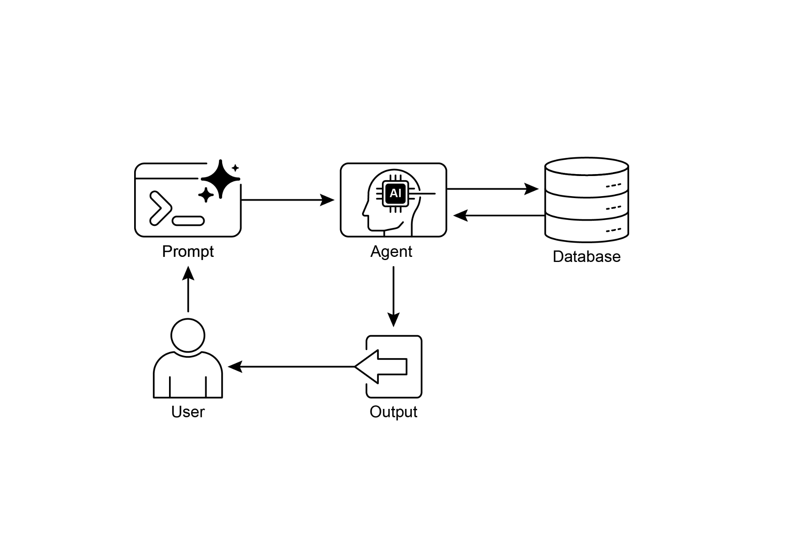
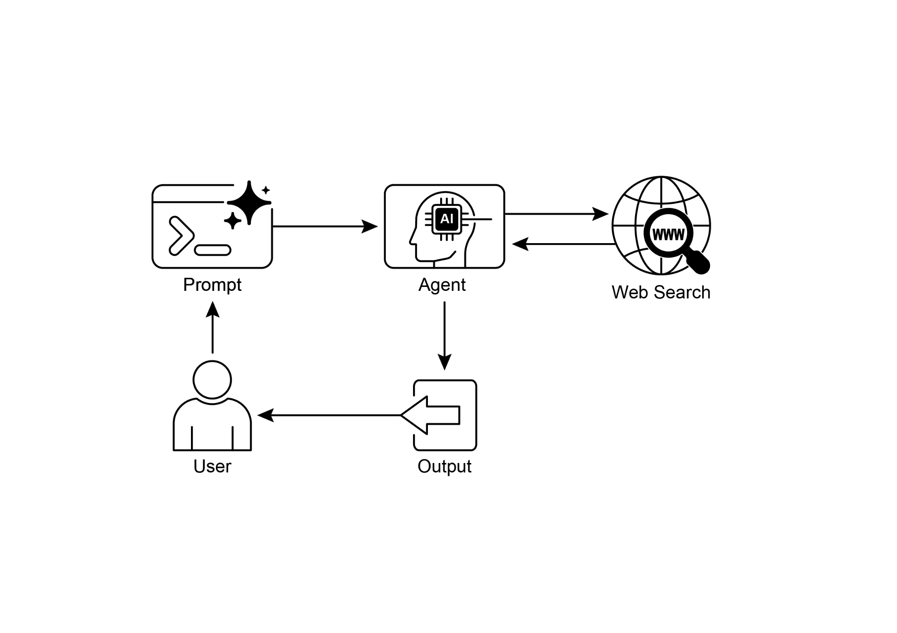

智能体将其分解为独立的子查询。它会分别发起 **总结：** 智能体式检索增强生成代表了标准

检索模式的一次精妙演进，将其从被动的数据管道转变为主动的

问题解决框架。通过嵌入能够评估

来源、调和冲突、分解复杂问题并使用外部工具的推理层，智能体显著提升了生成答案的可靠性与深度。这一

进步使 AI 更可信、更有能力，但也带来了

系统复杂度、延迟和成本方面的重要权衡，必须仔细

加以管理。

## 实际应用与用例

知识检索（检索增强生成）正在改变各行各业使用大语言模型的

方式，增强其提供更准确信息的能力。

## 动手代码示例（Google ADK）

为说明知识检索（检索增强生成）模式，我们来看三个示例。

首先，是如何使用 Google 搜索做检索增强生成，并将大语言模型锚定到搜索结果。

由于检索增强生成涉及访问外部信息，Google 搜索工具是内置

检索机制的直接示例，可用于增强大语言模型的知识。

[from google.adk.tools import google_search ][from google.adk.agents import Agent ]

[search_agent = Agent( ]

[name=\"research_assistant\", ]

[model=\"gemini-2.0-flash-exp\", ]

[instruction=\"You help users research topics. When asked, use the ][to retrieve. ]

[\# 该参数控制检索增强生成服务将返回多少相关文档块。 ]

[SIMILARITY_TOP_K = 5 ]

[\# 定义向量距离阈值的可选参数。 ][\# 该阈值决定检索结果允许的最大语义距离； ]

[\# 距离大于该值的结果可能会被过滤掉。 ]

[VECTOR_DISTANCE_THRESHOLD = 0.7 ]

[\# 初始化 VertexAiRagMemoryService 实例。 ][\# 这会建立与你的 Vertex AI RAG Corpus 的连接。 ][\# - rag_corpus: 指定 RAG Corpus 的唯一标识符。 ][\# - similarity_top_k: 设置相似结果的最大返回数量 ][import dotenv ]

[\# 加载环境变量（例如 OPENAI_API_KEY） ][dotenv.load_dotenv() ]

[\# 设置你的 OpenAI API 密钥（确保从 .env 加载或在此设置） ][\# os.environ\[\"OPENAI_API_KEY\"\] = \"YOUR_OPENAI_API_KEY\" ]

[\# \-\-- 1. 数据准备（预处理） \-\-- ][\# 加载数据 ]

[url = ]

[\"https://github.com/langchain-ai/langchain/blob/master/docs/docs/how\_] [to/state_of_the_union.txt\" ]

[res = requests.get(url) ]

[with open(\"state_of_the_union.txt\", \"w\") as f: ]

[f.write(res.text) ]

[documents: List\[Document\] ]

[generation: str ]

[\# \-\-- 3. 定义节点（函数） \-\-- ]

[def retrieve_documents_node(state: RAGGraphState) -\> RAGGraphState: ]

[\"\"\"根据用户问题检索文档。\"\"\" ]

[question = state\[\"question\"\] ]

[documents = retriever.invoke(question) ]

[return {\"documents\": documents, \"question\": question, ][\"generation\": \"\"} ]

[def generate_response_node(state: RAGGraphState) -\> RAGGraphState: ]

[\"\"\"基于检索到的文档使用大语言模型生成回复。\"\"\" ]

[question = state\[\"question\"\] ][workflow.add_node(\"generate\", generate_response_node) ]

[\# 设置入口点 ]

[workflow.set_entry_point(\"retrieve\") ]

[\# 添加边（转换） ]

[workflow.add_edge(\"retrieve\", \"generate\") ][workflow.add_edge(\"generate\", END) ]

[\# 编译图 ]

[app = workflow.compile() ]

[\# \-\-- 5. 运行检索增强生成应用 \-\-- ]

[if \_\_name\_\_ == \"\_\_main\_\_\": ]

[print(\"\\n\-\-- Running RAG Query \-\--\") ]

[query = \"What did the president say about Justice Breyer\" ]

## 一览

**是什么：** 大语言模型具备出色的文本生成能力，但从根本上受限于

其训练数据。这些知识是静态的，意味着不包含实时信息或私有的领域专用数据。因此，它们的回复可能

过时、不准确，或缺乏专业任务所需的特定上下文。这一

缺口限制了它们在需要当前且事实性答案的应用中的可靠性。

**为什么：** 检索增强生成（RAG）模式通过将大语言模型连接到外部知识源，提供了标准化解决方案。当收到查询时，

系统首先从指定的知识库中检索相关信息片段。

这些片段随后被附加到原始提示中，为其注入

及时且具体的上下文。然后，这个增强后的提示被发送给大语言模型，

● 智能体式检索增强生成超越了简单的信息检索：它使用

智能体主动对外部知识进行推理、验证和精炼，从而确保答案更准确、更可靠。

● 实际应用涵盖企业搜索、客户支持、法律研究，

以及个性化推荐。

## 结论

总之，检索增强生成（RAG）通过将大语言模型连接到外部、最新的

数据源，解决了其静态知识这一核心局限。

该过程首先检索相关信息片段，

然后增强用户的提示，使大语言模型能够生成更准确且具有上下文意识的回复。这一切得益于嵌入、

语义搜索和向量数据库等基础技术，它们基于语义查找信息。[*3.* ]基于图的检索增强生成（GraphRAG），

<https://arxiv.org/abs/2501.00309>

[*4.* ]LangChain 与 LangGraph：Leonie Monigatti，《检索增强生成

（RAG）：从理论到 LangChain 实现》，

[[*https://medium.com/data-science/retrieval-augmented-generation-rag-fro*](https://medium.com/data-science/retrieval-augmented-generation-rag-from-theory-to-langchain-implementation-4e9bd5f6a4f2)]
