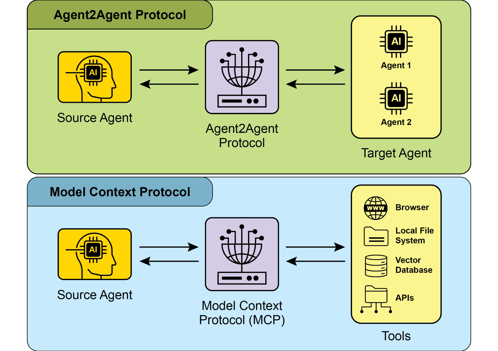

## 第15章：智能体间通信

（A2A）

面对复杂、多面的问题时，单个 AI 智能体即使具备先进能力，也常常力有不逮。为突破这一局限，智能体间通信（A2A）使可能基于不同框架构建的多样 AI 智能体能够有效协作。这种协作涵盖无缝协调、任务委派与信息交换。

Google 的 A2A 协议是一项开放标准，旨在促成这种通用通信。本章将探讨 A2A、其实际应用，以及它在 Google ADK 中的实现。

**核心参与方：** A2A 涉及三个主要实体：

● 用户：发起对智能体协助的请求。

● A2A 客户端（客户端智能体）：代表用户请求操作或信息的应用程序或 AI 智能体。

● A2A 服务器（远程智能体）：提供 HTTP 端点以处理客户端请求并返回结果的 AI 智能体或系统。远程智能体作为“不透明”系统运行，意味着客户端无需了解其内部运作细节。

**智能体卡片：** 智能体的数字身份由其智能体卡片定义，通常是一个 JSON

文件。该文件包含客户端交互与自动发现所需的关键信息，

包括智能体的身份、端点 URL 与版本。它还详述所支持的

["name": "Get Current Weather", ]

["description": "Retrieve real-time weather for any location.", ]

["inputModes": \[ ]

["text" ]

\], ]

["outputModes": \[ ]

["text" ]

\], ]

["examples": \[ ]

["What's the weather in Paris?", ]

["Current conditions in Tokyo" ]

\], ]

["tags": \[ ]

["weather", ]

["current", ]

["real-time" ]

/.well-known/agent.json）。这种方式可为公开或特定领域的用途提供广泛、往往可自动化的可访问性。

● **策展注册表**：提供集中式目录，智能体卡片在此发布，并可按特定条件查询。这很适合需要集中管理与访问控制的企业环境。

● **直接配置**：智能体卡片信息被嵌入或私下共享。

此方法适用于紧密耦合或私有系统，动态发现并非关键。

无论采用哪种方法，保护智能体卡片端点都很重要。

可通过访问控制、双向 TLS（mTLS）或网络限制实现，尤其当卡片包含敏感（但非机密）信息时。

**通信与任务：** 在 A2A 框架中，通信被结构化为

定期轮询服务器，通过发送新请求来检查

任务状态，直至其被标记为“已完成”或“失败”。

● 流式更新（服务器发送事件 - SSE）：适合接收实时、

增量结果。该方法建立从服务器到客户端的持久单向连接。

它使远程智能体能够持续推送更新，例如状态变更或部分结果，而客户端无需发起多次请求。

● 推送通知（Webhook）：专为运行时间很长或

资源密集型任务设计，此时维持恒定连接或频繁轮询效率低下。客户端可注册一个 webhook URL，当任务状态发生显著变化时（例如完成时），服务器会向该 URL 发送异步通知（一次“推送”）。

智能体卡片会指明智能体是否支持流式传输或推送通知。同步请求使用 sendTask 方法，客户端请求并期望对其查询得到一个完整、单一的答案。相比之下，流式请求使用 sendTaskSubscribe 方法建立持久连接，允许智能体随时间发回多个增量更新或部分结果。

[\# Streaming Request Example ]

[{ ]

[ "jsonrpc": "2.0", ]

[ "id": "2", ]

[ "method": "sendTaskSubscribe", ]

[ "params": { ]

["id": "task-002", ]

["sessionId": "session-001", ]

["message": { ]

["role": "user", ]智能体卡片声明：身份验证要求在智能体卡片中显式声明，该配置产物概述智能体的身份、能力与安全策略。这将身份验证管理集中化并加以简化。

凭证处理：智能体通常使用 OAuth 2.0 令牌或 API 密钥等安全凭证进行身份验证，并通过 HTTP 头传递。此方法可防止凭证暴露在 URL 或消息体中，从而增强整体安全性。

[A2A 与 MCP ]

A2A 是一项与 Anthropic 的模型上下文协议（MCP）互补的协议（见图 1）。MCP 侧重为智能体及其与外部数据和工具的交互构建上下文结构，而 A2A 则促进智能体之间的协调与通信，实现任务委派与协作。系统。因此，透彻理解 A2A 的核心组件与

运作方法，对于有效设计、实现并将其应用于构建可协作、可互操作的 AI 智能体系统至关重要。

[实际应用与用例]

智能体间通信对于在不同领域构建复杂 AI 解决方案不可或缺，

可实现模块化、可扩展性与增强的智能。

[● ]**多框架协作：** A2A 的主要用例是使

独立的 AI 智能体——无论其底层框架如何（例如 ADK、

LangChain、CrewAI）——能够通信与协作。这对于构建复杂的多智能体系统至关重要，其中不同智能体专长于问题的不同方面。

[● ]**自动化工作流编排：** 在企业场景中，A2A 可促成 [ignore\[import-untyped\] ]

[async def create_agent(client_id, client_secret) -\> LlmAgent: ]

["""Constructs the ADK agent.""" ]

[toolset = CalendarToolset(client_id=client_id, ][client_secret=client_secret) ]

[return LlmAgent( ]

[model='gemini-2.0-flash-001', ]

[name='calendar_agent', ]
