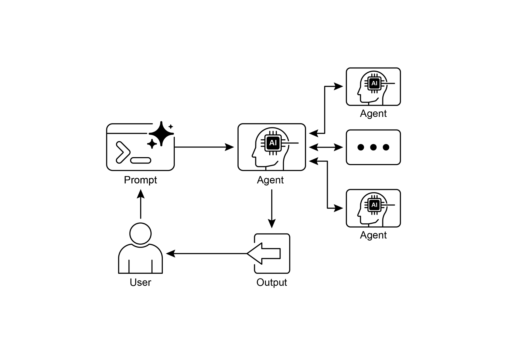

[description=\"An agent that can help manage a user\'s calendar\", ]

[instruction=f\"\"\" ]

[You are an agent that can help manage a user\'s calendar. ]

 

[Users will request information about the state of their calendar ][or to make changes to their calendar. Use the provided tools for ][interacting with the calendar API. ]

[https://github.com/a2aproject/a2a-samples/blob/main/samples/python/agents/birthda](https://github.com/a2aproject/a2a-samples/blob/main/samples/python/agents/birthday_planner_adk/calendar_agent/__main__.py)

[y_planner_adk/calendar_agent/\_\_main\_\_.py](https://github.com/a2aproject/a2a-samples/blob/main/samples/python/agents/birthday_planner_adk/calendar_agent/__main__.py)

 

[def main(host: str, port: int): ]

[\# 确认已设置 API 密钥。 ]

[\# 若使用 Vertex AI API，则不需要。 ]

[if os.getenv(\'GOOGLE_GENAI_USE_VERTEXAI\') != \'TRUE\' and not ][os.getenv( ]

[\'GOOGLE_API_KEY\' ]

[): ]

[raise ValueError( ]

[\'GOOGLE_API_KEY environment variable not set and \' ]

[\'GOOGLE_GENAI_USE_VERTEXAI is not TRUE.\' ]

[) ]

 

[skill = AgentSkill( ]

[agent_executor = ADKAgentExecutor(runner, agent_card) ]

 

[async def handle_auth(request: Request) -\> PlainTextResponse: ]

[await agent_executor.on_auth_callback( ]

[str(request.query_params.get(\'state\')), str(request.url) ]

[) ]

[return PlainTextResponse(\'Authentication successful.\') ]

 

[request_handler = DefaultRequestHandler( ]

[agent_executor=agent_executor, task_store=InMemoryTaskStore() ]

[) ]

 

[a2a_app = A2AStarletteApplication( ]

[agent_card=agent_card, http_handler=request_handler ]

[) ]

[routes = a2a_app.routes() ]如 Google Calendar。这一实践方法展示了 A2A 在

构建多智能体生态系统中的应用。

 

建议通过以下代码演示进一步探索 A2A：

[https://www.trickle.so/blog/how-to-build-google-a2a-project.](https://www.trickle.so/blog/how-to-build-google-a2a-project) 该链接提供的资源包括

Python 与 JavaScript 的示例 A2A 客户端与服务器、多智能体

Web 应用、命令行界面，以及面向多种智能体框架的示例实现。

 

[一览 ]

 

**是什么：** 单个 AI 智能体，尤其是基于不同框架构建的智能体，往往

难以独自应对复杂、多方面的问题。主要挑战在于缺乏一种通用语言或协议，使它们能够通信并 **可视化摘要**

状态，使智能体能够在交互过程中请求额外信息并保持

上下文。

[● ]A2A 鼓励采用模块化架构，使专业化智能体可以在

不同端口上独立运行，从而实现系统的可扩展性与分布式部署。

[● ]Trickle AI 等工具有助于可视化与追踪 A2A 通信，

帮助开发者监控、调试并优化多智能体系统。

● 虽然 A2A 是用于管理不同智能体之间任务与工作流的高层协议，

但模型上下文协议（MCP）则为大语言模型提供了与外部资源对接的标准化

接口

 

[结论 ]

 

智能体间通信（A2A）协议建立了一个至关重要的开放标准，以

克服单个 AI 智能体固有的隔离状态。通过提供通用的

[3. ]Google ADK <https://google.github.io/adk-docs/>

[4. ]Agent-to-Agent（A2A）协议入门：

<https://codelabs.developers.google.com/intro-a2a-purchasing-concierge#0>

5. Google AgentDiscovery - <https://a2a-protocol.org/latest/>

6. LangGraph、CrewAI 与 Google ADK 等不同 AI 框架之间的通信 [https://www.trickle.so/blog/how-to-build-google-a2a-project](https://www.trickle.so/blog/how-to-build-google-a2a-project#setting-up-your-a2a-development-environment)

7. 使用 A2A 协议设计协作式多智能体系统

[https://www.oreilly.com/radar/designing-collaborative-multi-agent-systems-with-](https://www.oreilly.com/radar/designing-collaborative-multi-agent-systems-with-the-a2a-protocol/)

[the-a2a-protocol/](https://www.oreilly.com/radar/designing-collaborative-multi-agent-systems-with-the-a2a-protocol/)
