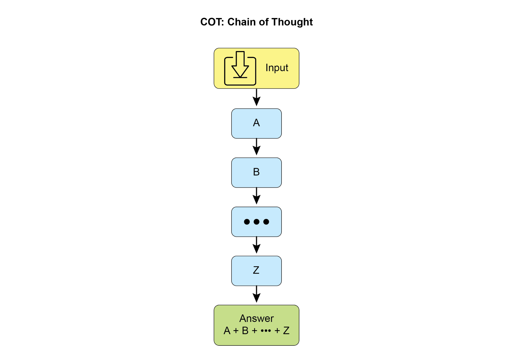
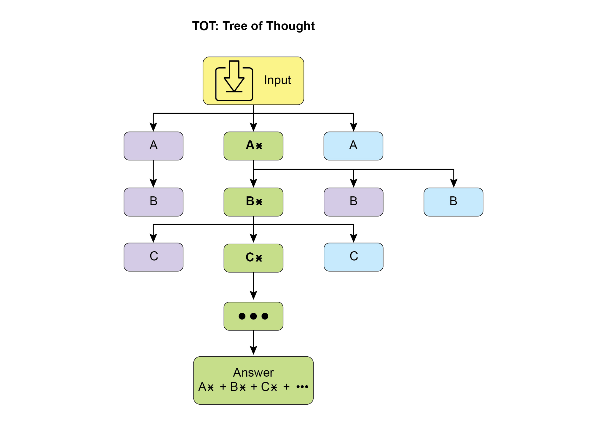

## [第17章：推理技术]

 

本章深入探讨智能体的高级推理方法，

重点关注多步逻辑推断与问题解决。这些技术超越了

简单的顺序操作，使智能体的内部推理显式化。

这使智能体能够分解问题、考量中间步骤，并得出更稳健、更准确的结论。这些高级

方法的一条核心原则是在推理阶段分配更多计算资源。也就是说，

给予智能体或底层大语言模型更多处理时间或步骤，

以处理查询并生成回复。智能体不再做一次快速的单轮处理，而是可以进行迭代精炼、探索多条求解路径，或使用外部

工具。推理阶段延长的处理时间往往能显著提升

准确性、连贯性与稳健性，尤其适用于需要

[2]

 

（ReAct）。增加推理时间有助于进行更全面的鉴别

诊断。

● **法律分析：** 支持分析法律文件与判例，以

形成论证或提供指导，详细说明所采取的逻辑步骤，并通过自我纠正

确保逻辑一致性。增加推理时间

有助于更深入的法律研究与论证构建。

 

## [推理技术]

 

首先，让我们深入了解用于增强 AI 模型

问题解决能力的核心推理技术。

 

**思维链（CoT）** 提示通过模拟逐步思考过程，显著增强大语言模型的复杂推理

能力（见图1）。其做法不是直接给出

[3]

[4]

 

[1. \*\*分析查询：\*\* 理解用户问题的核心主题与具体 ][要求。识别关键实体、关键词， ][以及所寻求信息的类型。 ][2. \*\*制定搜索查询（面向知识库）：\*\* 基于你的 ][分析，生成一组精确的搜索查询，用于 ][从知识库或外部工具中检索相关信息。 ]

[3. \*\*模拟信息检索（自我纠正/推理）：\*\* ][对每个搜索查询，在脑海中设想你 ][预期会找到哪类信息。若检索到内容，哪些会是 ][最相关的片段？思考潜在歧义或 ][缺失部分。 ]

[4. \*\*综合信息：\*\* 基于模拟检索与 ][你对用户原始查询的理解，将所获信息综合为连贯完整的答案。确保查询的所有 ][方面都得到回应。 ]

[5]

 

[使用量子力学。 ]

[- 从「applications」：预期包括药物发现、材料科学、 ][密码学、优化。 ]

 

[\*\*思考 4（综合信息）：\*\* ]

[经典计算机使用比特（0 或 1），按顺序处理信息。 ][量子计算机使用量子比特，可以是 0、1，或 ][同时为两者（叠加态），并且可以纠缠，从而允许 ][截然不同的计算方式。这使它们能够 ][比经典计算机高效得多地解决某些问题（如分解大数或模拟 ][复杂分子）。一个潜在应用是药物发现：量子计算机 ][能够以前所未有的精度模拟分子相互作用， ][加速新药研发。 ]

 

[\*\*思考 5（审阅与精炼）：\*\* ]

[6]

 

最终确定答案。这一迭代过程增强了模型处理

需要战略规划与决策制定的高难度任务的能力。

[7]

 

定义的五步分析与修订工作流。随后给出一篇质量欠佳的社交媒体帖子「初稿」。

「自我纠正智能体的思考过程」构成演示的核心。在此，智能体按照指令批判性评估

草稿，指出参与度低、

行动号召模糊等弱点。接着提出具体改进建议，包括使用

更有冲击力的动词与表情符号。过程以「最终修订内容」收尾——一份融入了自我识别

调整后的润色、显著改进的版本。

 

[你是一个高度挑剔、注重细节的自我纠正智能体。 ][你的任务是对照原始要求审阅先前所生成的内容， ][并找出可改进之处。 ][你的目标是精炼内容，使其更准确、 ][更全面、更有吸引力，并与提示词对齐。 ]

[8]

 

[line: \'GreenTech Gadgets\'.\" ]

 

[\*\*初稿（待纠正内容）：\*\* ]

 

[\"我们有新产品。它们既环保又科技。现在就购买 GreenTech ][Gadgets！\" ]

 

[\*\*自我纠正智能体的思考过程（内部思维链输出—— ][由提示词鼓励）：\*\* ]

 

[\*\*思考 1（理解原始要求）：\*\* ][- 简短、有吸引力的社交媒体帖子。 ]

[- 最多 150 个字符。 ]

[- 宣布「GreenTech Gadgets」——一条新的环保产品线。 ]

 

[\*\*思考 2（分析当前内容）：\*\* ]

[9]

 

[🌱][ 探索 GreenTech Gadgets！我们全新的环保产品线融合 ][创新与可持续性。走绿色，走智能！立即选购！ ][#EcoFriendly #GreenTech ]

 

从根本上说，该技术将质量控制措施直接整合进

智能体的内容生成过程，从而产出更精炼、更精确、更优质的结果，

更能有效满足复杂的用户需求。

 

**程序辅助语言模型（PALMs）** 将大语言模型与符号推理

能力相结合。这种整合使大语言模型能够生成并执行代码（例如

Python），作为其问题解决过程的一部分。PALMs 将复杂计算、

逻辑运算与数据操作卸载到确定性编程环境中。该方法利用传统编程在任务上的优势

[10]

 

[\"\"\", ]

[code_executor=\[BuiltInCodeExecutor\], ]

[) ]

[root_agent = Agent( ]

[name=\"RootAgent\", ]
