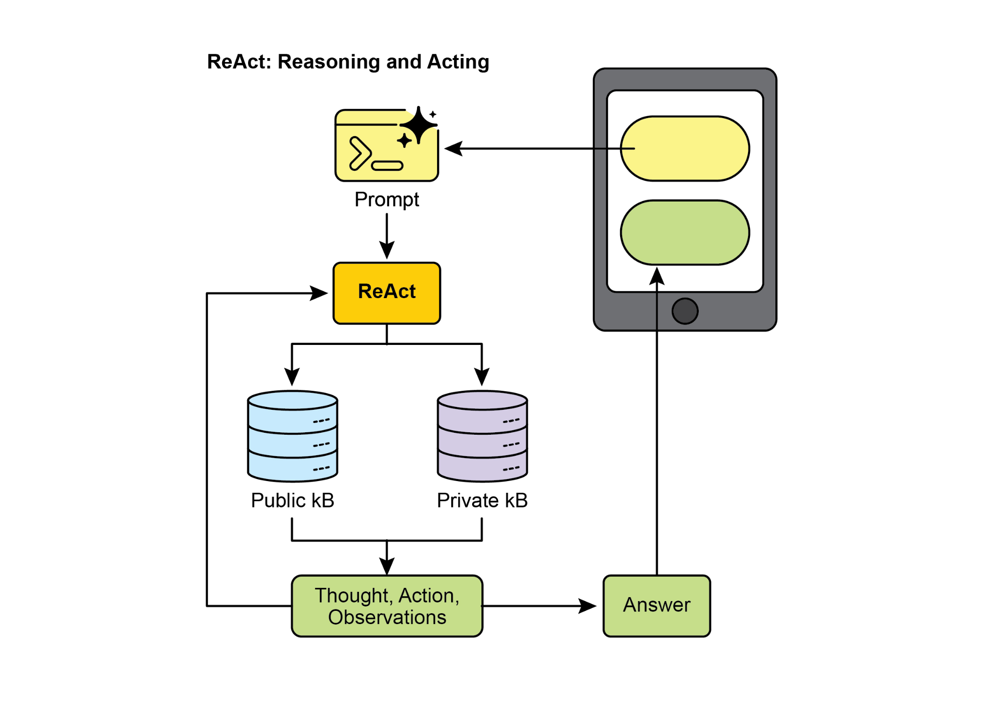
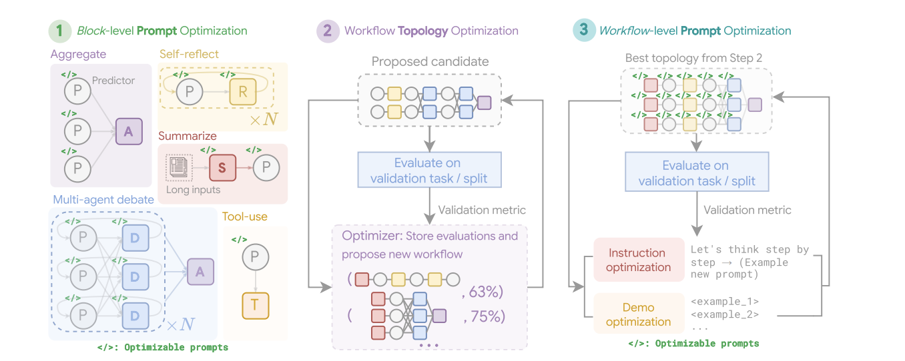
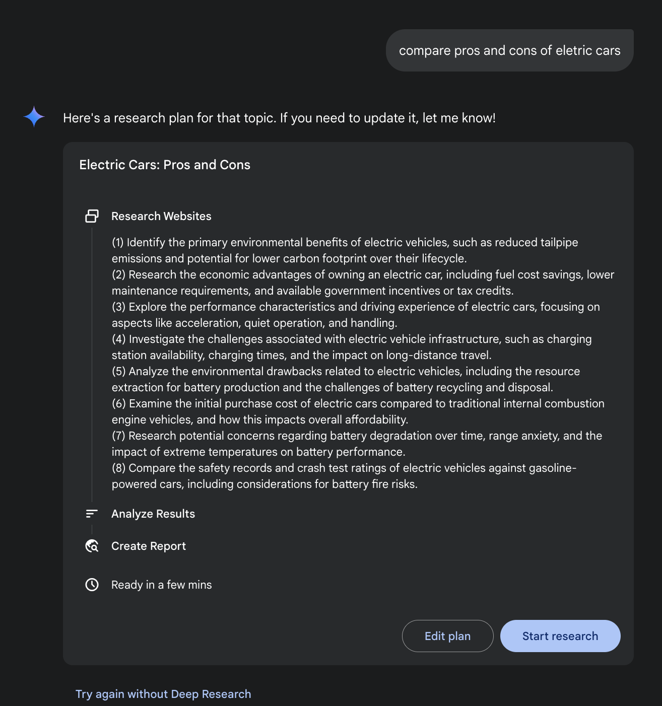

[model=\"gemini-2.0-flash\", ]

[description=\"Root Agent\", ]

[tools=\[agent_tool.AgentTool(agent=search_agent), ][agent_tool.AgentTool(agent=coding_agent)\], ][) ]

 

**可验证奖励强化学习（RLVR）：** 尽管有效，许多大语言模型采用的标准思维链（CoT）提示是一种较为基础的推理方法。它生成单一、预先确定的思路，而没有

[11 ]

[12 ]

 

通过借助集体智慧来提升最终答案的整体质量。该方法如同人工智能版的同行评议，能够形成透明且可信的推理过程记录。最终，它标志着从由单个智能体给出答案，转向由智能体协作团队共同寻找更稳健、经充分验证的解决方案。

 

**GoD**（辩论图，Graph of Debates）是一种先进的智能体式框架，它将讨论重新构想为动态、非线性的网络，而非简单的链条。在该模型中，

论点是各个节点，由表示诸如“支持”或“反驳”等关系的边相连，从而反映真实辩论的多线程本质。这种

结构允许新的探究路线动态分支、独立演进，甚至随时间合并。结论并非在序列末端得出，而是

通过识别整个图中最稳健、得到充分支撑的论点簇来达成。

在此语境下，“得到充分支撑”指的是牢固确立的知识

[13 ]

 

所配置的那些。例如，在针对 HotpotQA 数据集进行优化时，“辩论者”（Debator）智能体的提示被创造性地设定为：让它充当“某大型出版物的专家事实核查员”。其优化后的任务是仔细审阅

其他智能体提出的答案，将其与所提供的上下文

段落交叉核对，并找出任何不一致或缺乏依据的主张。这种在模块级优化中发现的专门角色扮演提示，旨在使辩论者智能体在被放入

更大工作流之前，就能高效地综合信息。

 

[**2. 工作流拓扑优化：** ]在局部优化之后，MASS 通过从可定制的设计空间中选择并安排不同的智能体交互，来优化

工作流拓扑。为使该搜索高效，MASS 采用一种

影响力加权方法。该方法通过衡量各拓扑相对于基线智能体的性能增益，计算其“增量影响力”，并

[14 ]

 

构建模块（聚合、反思、辩论、总结与工具使用）。第一

阶段——模块级提示优化——独立优化每个智能体模块的提示。第二阶段——工作流拓扑优化——从影响力加权的设计空间中采样有效的系统

配置，并整合已优化的

提示。最后阶段——工作流级提示优化——是在识别出第二阶段的最优工作流之后，对整个多智能体系统再进行一轮

提示优化。

 

[**3. 工作流级提示优化：** ]最后阶段对整个系统的提示进行全局优化。在确定表现最佳的拓扑之后，

将这些提示作为单一、整合的整体进行微调，以确保它们适用于编排，并优化智能体之间的相互依赖。例如，在

为 DROP 数据集找到最佳拓扑之后，最终优化阶段会精炼

“预测者”（Predictor）智能体的提示。最终优化后的提示非常详尽，

[15 ]

 

主题，将其拆解为子问题，以网络搜索作为工具，并

综合其发现。

 

**深度研究。** 术语“深度研究”描述的是一类 AI 智能体式工具，

旨在充当不知疲倦、条理分明的研究助手。该领域的主要平台

包括 Perplexity AI、Google 的 Gemini 研究能力，以及 OpenAI 的

ChatGPT 中的高级功能（见图 5）。

[16 ]

 

这些工具带来的根本转变，在于搜索过程本身的变化。

标准搜索会立刻给出链接，把综合工作留给

你。深度研究采用不同的模式。在这里，你向 AI 下达

复杂查询，并赋予它一个“时间预算”——通常是几分钟。换取这份耐心，你将得到一份详细报告。

 

在此期间，AI 以智能体式方式代表你工作。它自主地

执行一系列对人而言极为耗时的

复杂步骤：

 

1. 初步探索：它根据你的初始

提示运行多次、有针对性的搜索。

[17 ]

 

GPU，而是采用更复杂或更耗费资源的推理

策略。此类策略的一个典型例子是：指示模型生成多个可能的答案——例如通过多样化束搜索或

自一致性等方法——然后采用选择机制来识别

最优输出。这种迭代精炼或多候选生成

过程需要更多计算周期，但能显著提升最终回复的质量。

 

该原则为智能体系统的部署提供了一个至关重要的框架，有助于做出知情且经济合理的

决策。它挑战了“更大的模型总是带来更好性能”这一直观

观念。该定律认为：一个较小的模型，若在推理时被赋予更充足的“思考预算”，

有时可以超越一个大得多、却依赖

更简单、计算强度更低的生成过程的模型。此处的“思考预算”

[18 ]

 

[动手代码示例 ]

 

由 Google 开源的 DeepSearch 代码，可通过

gemini-fullstack-langgraph-quickstart 仓库获取（图 6）。该仓库为

开发者提供模板，用于使用 Gemini 2.5 与 LangGraph 编排框架构建全栈 AI 智能体。这一开源技术栈便于
