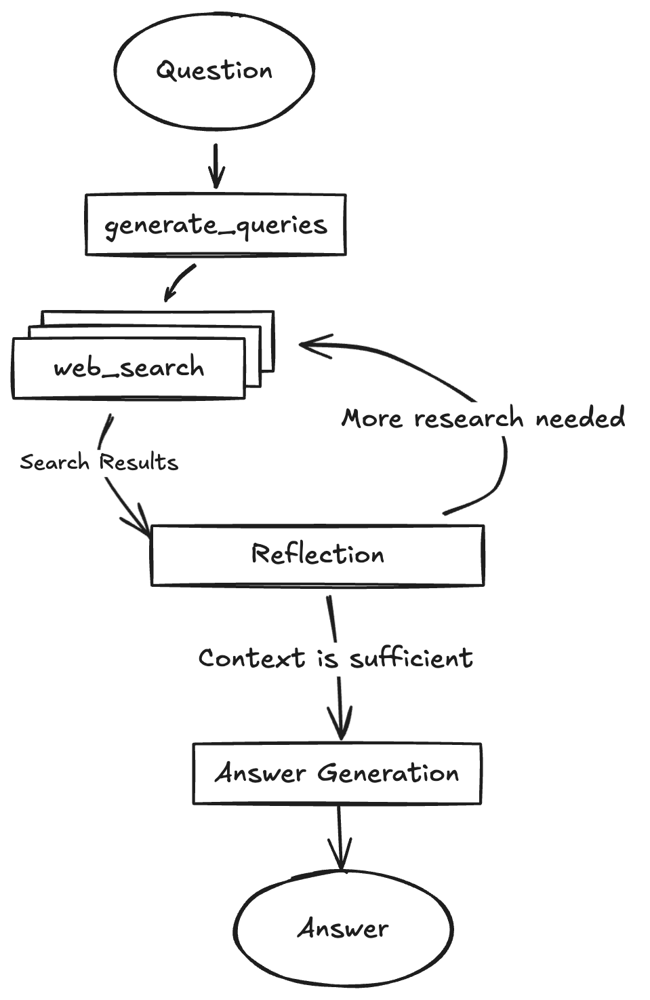
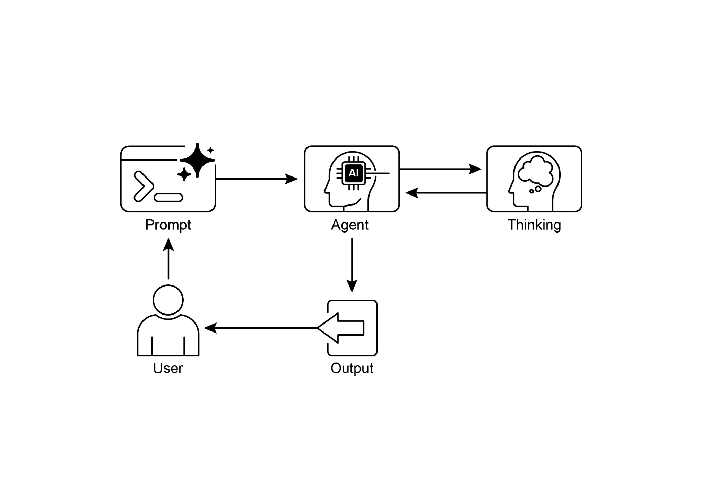

基于智能体架构的实验，并可与本地

大语言模型（如 Gemma）集成。它利用 Docker 与模块化项目脚手架实现快速

原型开发。需要注意的是，此版本提供的是结构良好的

[19 ]

 

LangGraph 智能体使用 Google Gemini 模型动态生成搜索查询，

并通过 Google Search API 集成网络研究。系统采用反思式推理来识别知识缺口，迭代优化搜索，并

综合带引用的答案。前端与后端支持热重载。

该项目的结构包含独立的 frontend/ 与 backend/ 目录。

搭建要求包括 Node.js、npm、Python 3.8+，以及 Google Gemini API 密钥。在 backend 的 .env 文件中配置 API 密钥后，即可安装后端（使用 pip install .）与前端（npm install）的依赖。开发

服务器可通过 make dev 同时运行，也可分别启动。后端智能体

定义于 backend/src/agent/graph.py，负责生成初始搜索查询、开展网络研究、执行知识缺口分析、迭代优化查询，并

使用 Gemini 模型综合带引用的答案。生产部署时，

由后端服务器交付静态前端构建产物，并需要 Redis 用于流式传输

实时输出，以及 Postgres 数据库用于管理数据。可构建 Docker 镜像

[20 ]

 

[# 最终确定答案 ]

[builder.add_edge("finalize_answer", END) ]

 

[graph = builder.compile(name="pro-search-agent") ]

 

图4：使用 LangGraph 的 DeepSearch 示例（代码来自 backend/src/agent/graph.py）

 

[那么，智能体在想什么？ ]

 

总之，智能体的思考过程是一种将

推理与行动相结合以解决问题的结构化方法。该方法使智能体能够显式规划其步骤、监控进展，并与外部工具交互以收集信息。

 

其核心是，智能体的“思考”由强大的大语言模型驱动。该大语言模型生成

[21 ]

 

推理。相比之下，对于需要大量动作的决策任务，例如

在模拟环境中导航，思考可能使用得更为节制，允许智能体自行决定何时需要思考

 

[一览 ]

 

**是什么：** 复杂问题解决往往需要的不只是单一、直接的答案，

这对 AI 构成重大挑战。核心问题在于如何使 AI 智能体能够应对

需要逻辑推断、任务分解与战略规划的多步任务。若缺乏结构化方法，智能体可能无法处理复杂细节，从而导致

不准确或不完整的结论。这些高级推理方法论

旨在使智能体内部的“思考”过程显式化，使其能够系统性地

应对挑战。

[22 ]

[23 ]

 

● 思维树与自我纠正赋予智能体至关重要的

审慎能力，使其能够评估多种策略、从错误中回溯，并在执行前改进自身计划。

● 辩论链（CoD）等协作框架标志着从

孤立智能体向多智能体系统的转变，智能体团队可以共同推理，

以应对更复杂的问题并减少个体偏见。

● 深度研究等应用展示了这些技术如何最终形成

能够完全自主地代表用户执行复杂、长时任务（例如深入

调查）的智能体。

● 为构建高效的智能体团队，MASS 等框架可自动

优化个体智能体的指令方式及其交互方式，

确保整个多智能体系统达到最优表现。

● 通过整合这些推理技术，我们构建的智能体不仅是

自动化的，更是真正自主的，能够被信任去规划、行动，并

[24 ]

 

管理并解决复杂问题。最终，通过将显式推理与

行动能力相结合，这些方法论正完成将 AI 转变为真正智能体式问题解决者的进程。

 

[参考文献 ]

 

相关研究包括：

 

[1. ]"Chain-of-Thought Prompting Elicits Reasoning in Large Language Models" by

Wei et al. (2022)

[2. ]"Tree of Thoughts: Deliberate Problem Solving with Large Language Models" by

Yao et al. (2023)

[3. ]"Program-Aided Language Models" by Gao et al. (2023) [4. ]"ReAct: Synergizing Reasoning and Acting in Language Models" by Yao et al.

(2023)
